<p align="center">
  
</p>

<h1 align="center">EmuLabZip</h1>

<p align="center">
  <b>Inspect, monitor and debug the apps running in your Android emulators and iOS simulators.</b><br />
  A fast, beautiful, open-source developer lab written in Rust.
</p>

<p align="center">
  <a href="https://github.com/LuisPeixoto/EmuLabZip/actions/workflows/ci.yml"></a>
  <a href="LICENSE"></a>
  <a href="https://github.com/LuisPeixoto/EmuLabZip/releases"></a>
  
  
  <a href="CONTRIBUTING.md"></a>
</p>

<p align="center">
  <a href="#install">Install</a> ·
  <a href="#features">Features</a> ·
  <a href="docs/getting-started.md">Getting started</a> ·
  <a href="docs/logs.md">Logs</a> ·
  <a href="docs/performance.md">Performance</a> ·
  <a href="docs/storage.md">Storage</a> ·
  <a href="docs/network.md">Network</a> ·
  <a href="docs/traces.md">Traces</a> ·
  <a href="docs/crashes.md">Crashes</a> ·
  <a href="docs/layout.md">Layout</a> ·
  <a href="docs/sessions.md">Sessions</a> ·
  <a href="docs/mcp.md">MCP</a> ·
  <a href="docs/cli.md">CLI</a> ·
  <a href="docs/architecture.md">Architecture</a> ·
  <a href="docs/roadmap.md">Roadmap</a> ·
  <a href="CONTRIBUTING.md">Contributing</a>
</p>

<p align="center">
  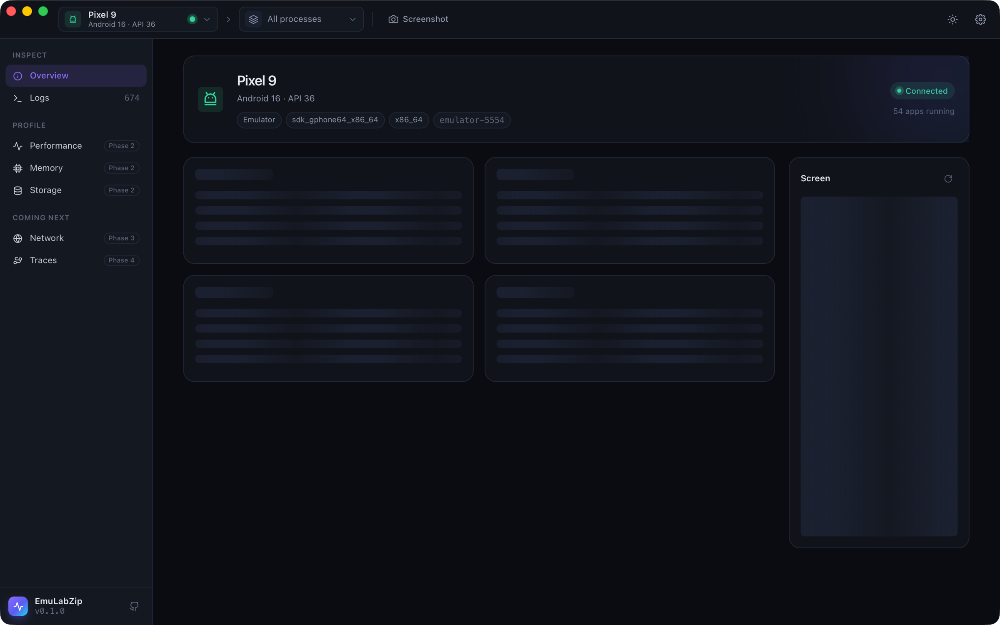
</p>

EmuLabZip connects to your running emulators and simulators on its own and brings everything you reach for while
debugging into one window: what the device is, what it is logging, how fast your app runs, where its memory goes and
what it keeps on disk and what it says to the internet; and then it lets you change that: mock a response, stop a
request, record a whole run and compare two devices. It ships as a native desktop app and as a command-line tool, and as an MCP server for AI assistants.

## Highlights

- **Android and iOS, side by side.** Android emulators and devices through a pure-Rust ADB client, iOS simulators
  through `simctl`. Switch between them in one click.
- **Zero setup.** Start an emulator or boot a simulator and it shows up. Nothing is installed on the device.
- **Logs that keep up.** logcat and the iOS unified log in one virtualized table that stays smooth at thousands of
  lines per second, with level, tag, text, regex and per-app filters.
- **Live performance.** CPU, memory, frame rate, janky frames and battery for the app you pick, charted as it runs.
- **Find what grew.** Memory snapshots with a diff by category, and heap dumps (`.hprof`) or memory graphs
  (`.memgraph`) one click away.
- **Look inside the sandbox.** Browse an app's files and open SQLite databases, SharedPreferences, property lists,
  JSON and images in place, with read-only SQL queries.
- **See the traffic.** A built-in proxy decrypts your app's HTTPS and lists every request with its headers, decoded
  bodies and timing, and exports HAR. One click points a device at it and another puts it back.
- **Change the traffic.** Mock a response, slow a request down, block it, or stop it and edit it, with
  [rules and breakpoints](docs/mocks.md). Read [WebSocket messages](docs/websockets.md), talk HTTP/3 to servers, and open
  [packet captures](docs/pcap.md).
- **See the screen as a screen reader does.** The [layout](docs/layout.md) of any screen, with an accessibility audit
  for missing labels, small touch targets and low contrast.
- **Record a run.** A [session](docs/sessions.md) keeps the logs, CPU and memory, requests, crashes and screenshots of a
  run in one file. [CI mode](docs/ci.md) records around your test command and keeps its exit code.
- **Everything about the device.** OS and build, hardware, display, battery, storage and locale, with a live screen
  preview. Click any value to copy it.
- **Native and light.** A Rust core with a Tauri interface: a small download, a fast start and low memory use.
- **Scriptable.** The `emulabzip` command prints tables for people and JSON for scripts.
- **Built on public interfaces.** No private frameworks and no on-device agents, so it keeps working when Xcode and
  Android Studio update. Read [how the official tools work](docs/research/how-the-official-tools-work.md).

## Screenshots

<p align="center">
  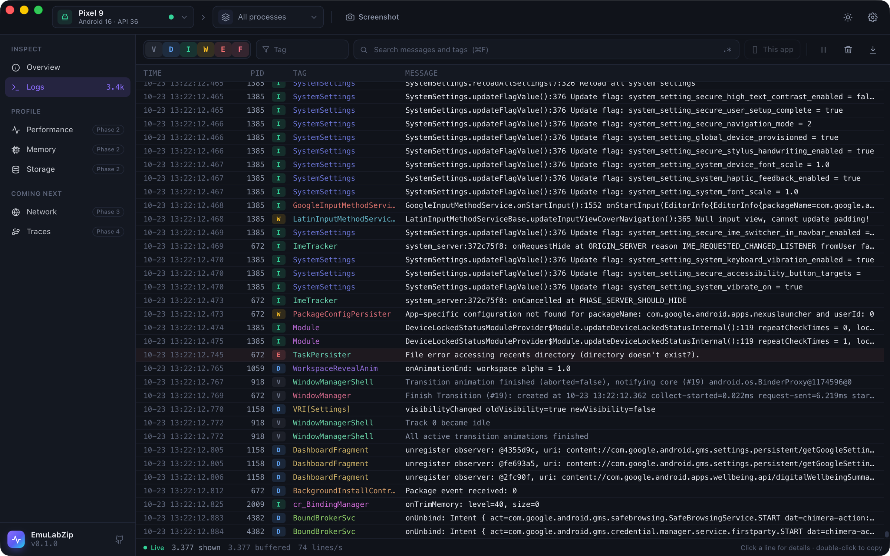<br />
  <sub><b>Logs</b>: logcat and the unified log, filtered as you type.</sub>
</p>

<p align="center">
  <br />
  <sub><b>Network</b>: decrypted requests with bodies and timing, and the protocol each one used (<code>h2</code>, then <code>h3</code>).</sub>
</p>

<p align="center">
  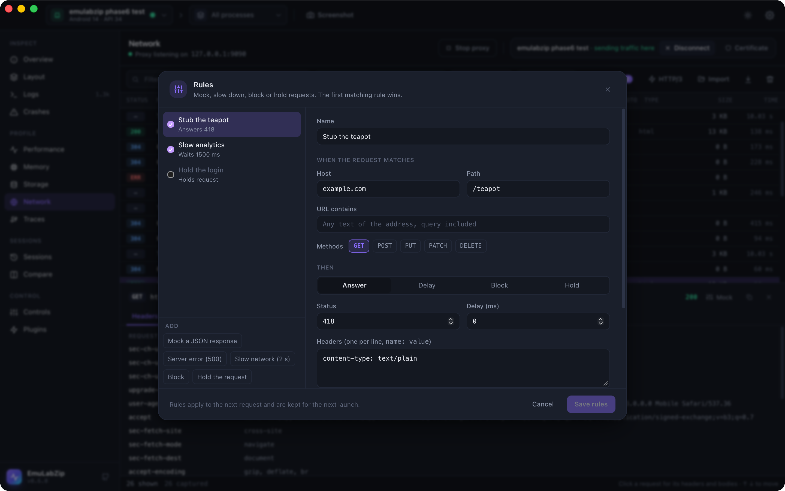<br />
  <sub><b>Rules</b>: answer, slow down, block or hold a request, and see the result in the list.</sub>
</p>

<table>
  <tr>
    <td width="50%">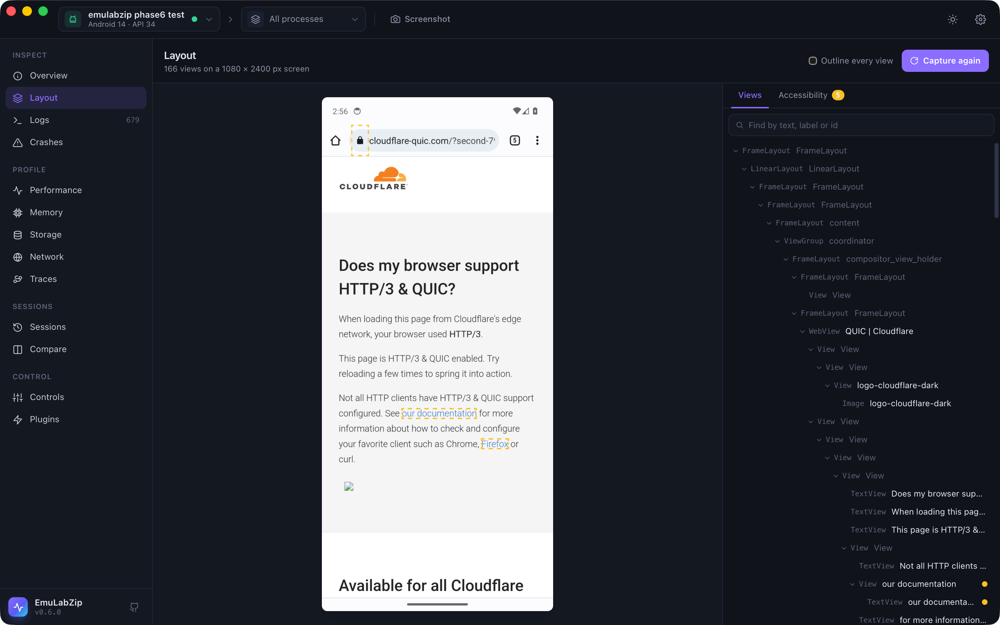<br /><sub><b>Layout</b>: every view, with its name, size and flags.</sub></td>
    <td width="50%">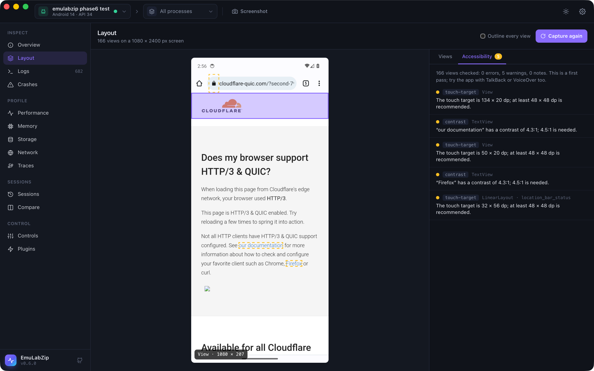<br /><sub><b>Accessibility</b>: touch targets, labels and contrast, with what to fix.</sub></td>
  </tr>
  <tr>
    <td width="50%">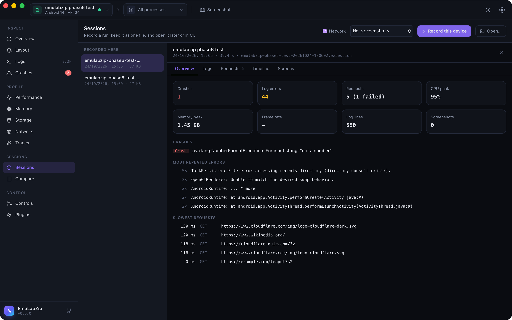<br /><sub><b>Sessions</b>: a whole run in one file: errors, crashes, requests, CPU and memory.</sub></td>
    <td width="50%">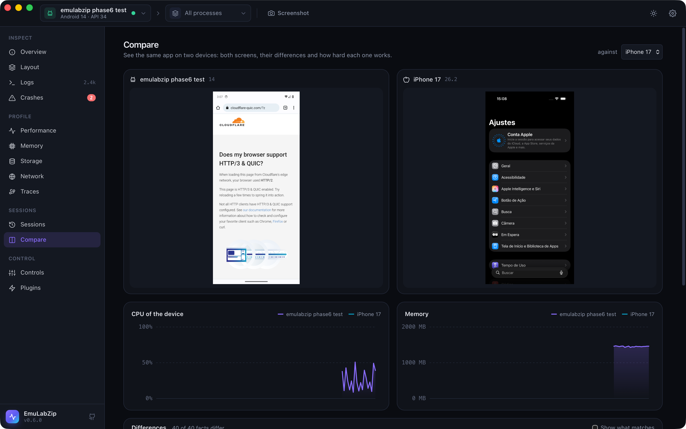<br /><sub><b>Compare</b>: two devices, their screens, charts and differences.</sub></td>
  </tr>
</table>

<p align="center">
  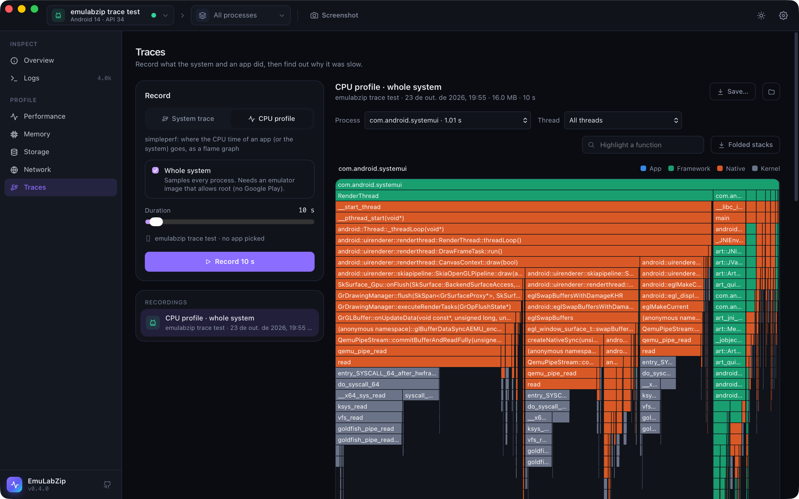<br />
  <sub><b>Traces</b>: a CPU profile as a flame graph, coloured by whose code it is.</sub>
</p>

<p align="center">
  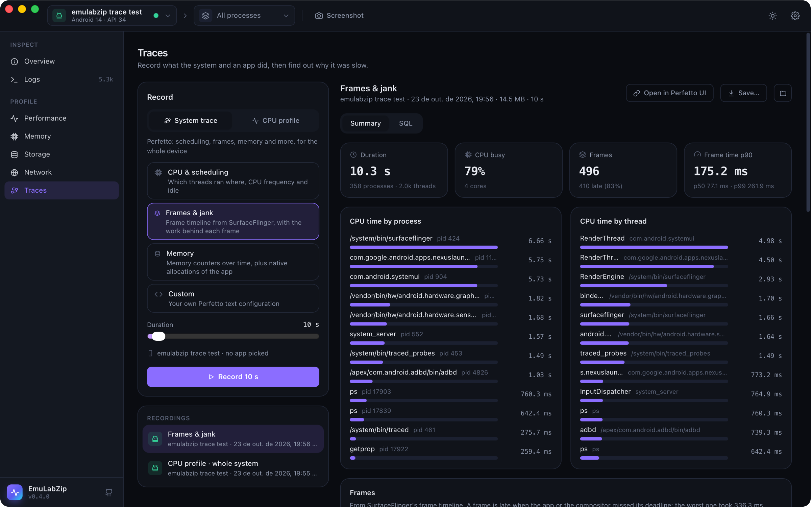<br />
  <sub><b>Traces</b>: a Perfetto system trace, summarized, with SQL and the Perfetto UI one click away.</sub>
</p>

<p align="center">
  <br />
  <sub><b>Crashes</b>: crashes, native crashes and ANRs with their stacks and what to try next.</sub>
</p>

<table>
  <tr>
    <td width="50%">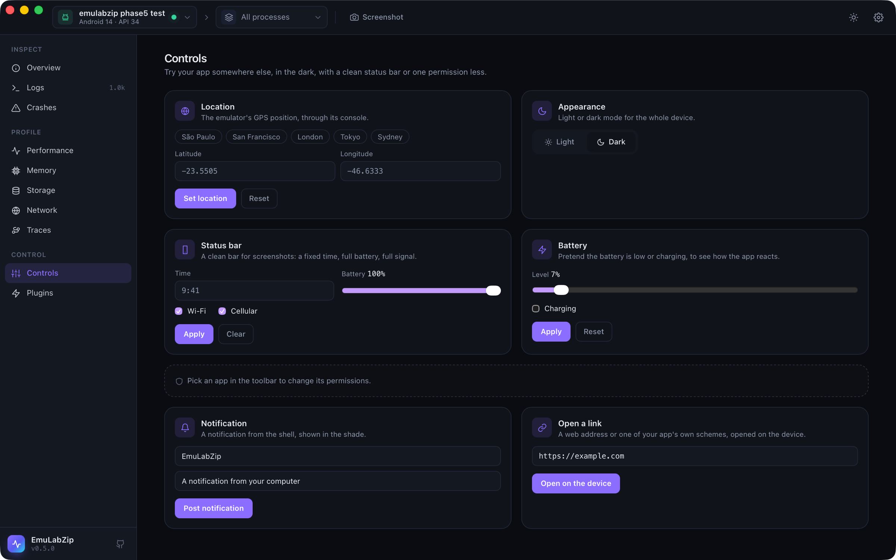<br /><sub><b>Controls</b>: another place, dark mode, a clean status bar, a low battery.</sub></td>
    <td width="50%">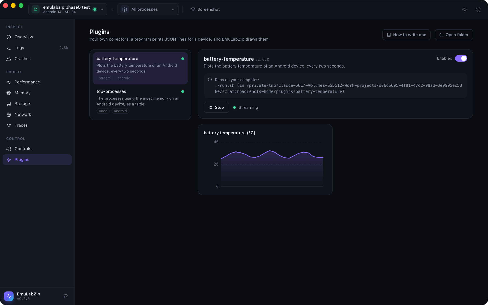<br /><sub><b>Plugins</b>: your own collector, charted live, after you enable it.</sub></td>
  </tr>
</table>

<table>
  <tr>
    <td width="50%">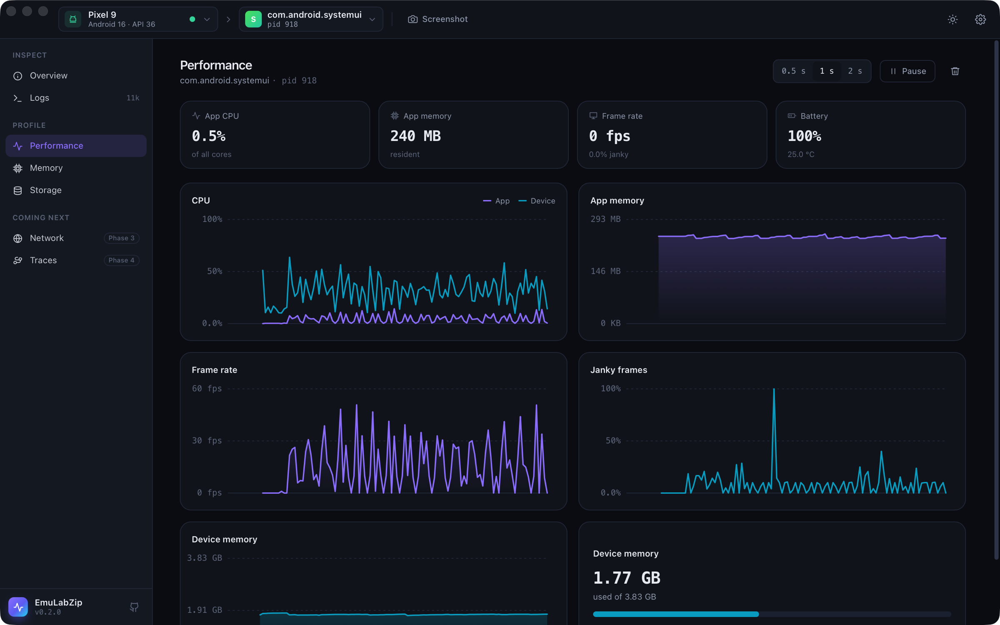<br /><sub><b>Performance</b>: CPU, memory, frames and battery, live.</sub></td>
    <td width="50%">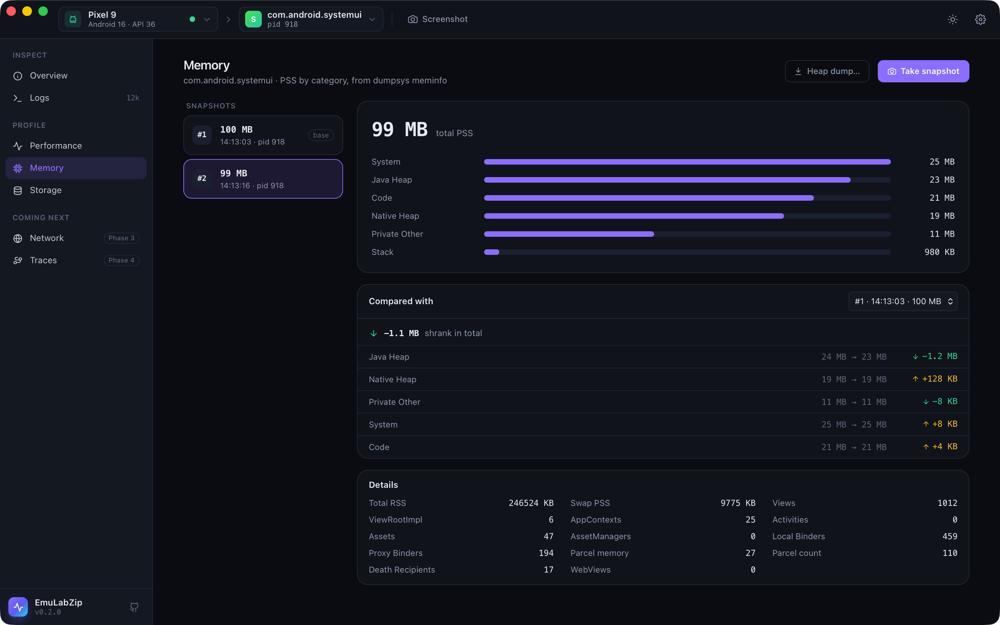<br /><sub><b>Memory</b>: snapshots, diffs and heap dumps.</sub></td>
  </tr>
  <tr>
    <td width="50%">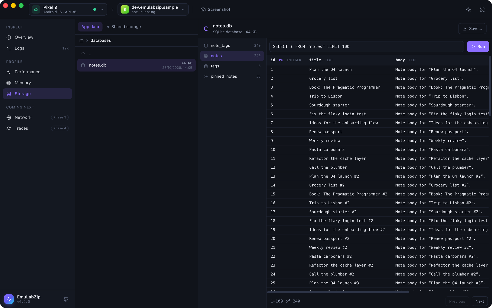<br /><sub><b>Storage</b>: SQLite, preferences and files, in place.</sub></td>
    <td width="50%">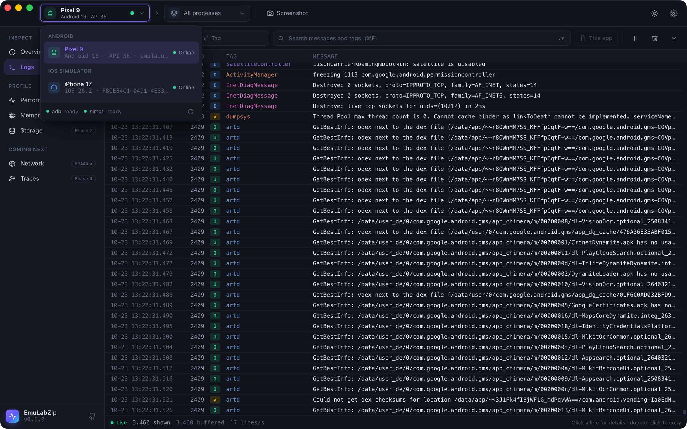<br /><sub><b>Devices</b>: Android emulators and iOS simulators in one picker.</sub></td>
  </tr>
</table>

## Features

| | Android | iOS Simulator |
|---|:---:|:---:|
| Automatic device discovery | ✅ | ✅ |
| Device overview (OS, build, hardware, display, battery, locale) | ✅ | ✅ |
| Installed and running apps | ✅ | ✅ |
| Live log streaming with filters and export | ✅ | ✅ |
| Screenshots and live screen preview | ✅ | ✅ |
| Command line | ✅ | ✅ |
| CPU and memory charts | ✅ | ✅ |
| Frame rate, janky frames and battery charts | ✅ | — |
| Memory breakdown, snapshots and diffs | ✅ | ✅ |
| Heap dumps (`.hprof`) and memory graphs (`.memgraph`) | ✅ | ✅ |
| File browser with SQLite, preferences and property list viewers | ✅ | ✅ |
| Network inspector: decrypted HTTP(S), HAR export | ✅ | ✅ |
| Perfetto system traces with summary and SQL | ✅ | — |
| CPU flame graphs (simpleperf, Time Profiler) and Instruments recordings | ✅ | ✅ |
| Crashes, native crashes and ANRs, with stacks and hints | ✅ | ✅ (crashes) |
| Device controls: location, dark mode, status bar, permissions, push | ✅ | ✅ |
| MCP server for AI assistants, and plugins | ✅ | ✅ |
| Mocks, delays, blocks and breakpoints; WebSocket messages; HTTP/3; packet capture import | ✅ | ✅ |
| Layout inspection and accessibility audit | ✅ | ✅ (Simulator.app open) |
| Sessions, CI mode and comparing two devices | ✅ | ✅ |

See the [roadmap](docs/roadmap.md) for what each phase contains.

## Install

### Desktop app

Download the installer for your system from the [latest release](https://github.com/LuisPeixoto/EmuLabZip/releases):
`.dmg` for macOS (Apple silicon and Intel), `.msi` or `.exe` for Windows, and `.deb`, `.rpm` or `.AppImage` for
Linux.

You also need the tools for the platforms you work with:

- **Android**: the SDK platform tools (`adb`), which Android Studio installs.
- **iOS**: a Mac with Xcode.

### Build from source

You need [Rust](https://rustup.rs) (stable), [Node.js](https://nodejs.org) 20 or newer and, on Linux, the
[Tauri system dependencies](https://tauri.app/start/prerequisites/#linux).

```bash
git clone https://github.com/LuisPeixoto/EmuLabZip.git
cd EmuLabZip/apps/desktop
npm install
npm run tauri build
```

### Command-line only

```bash
cargo install --git https://github.com/LuisPeixoto/EmuLabZip emulabzip-cli
```

Pre-built CLI archives are attached to every release as well.

## Quick start

```bash
emulator -avd Pixel_9            # or: xcrun simctl boot "iPhone 17"
emulabzip devices                # what is running
emulabzip info                   # what it is
emulabzip logs --level warn      # what it says
emulabzip screenshot             # what it shows
emulabzip perf --app com.example.app            # how fast it runs
emulabzip db com.example.app databases/app.db   # what it stores
emulabzip net --har capture.har                 # what it says to the internet
emulabzip a11y                                  # what a screen reader would trip over
emulabzip ci -o run.ezsession -- ./gradlew connectedCheck   # a recording around your tests
```

In the desktop app, pick the device in the top-left corner, then your app next to it. Read the
[getting started guide](docs/getting-started.md) for a tour.

## Documentation

| Guide | What it covers |
|-------|----------------|
| [Getting started](docs/getting-started.md) | Install, connect a device, find your way around |
| [Android](docs/android.md) | How EmuLabZip talks to ADB, environment variables, device states |
| [iOS Simulator](docs/ios-simulator.md) | Requirements, what `simctl` provides, taming the unified log |
| [Logs](docs/logs.md) | Filters, regular expressions, pausing and export |
| [Performance](docs/performance.md) | What each chart measures and where the numbers come from |
| [Memory](docs/memory.md) | Snapshots, diffs, heap dumps and memory graphs |
| [Storage](docs/storage.md) | Storage roots, viewers and read-only SQL |
| [Network](docs/network.md) | The proxy, the certificate, pinned apps and HAR export |
| [Traces](docs/traces.md) | Perfetto, simpleperf and Instruments recordings, flame graphs, SQL |
| [Crashes](docs/crashes.md) | Crashes, native crashes and ANRs with their stacks, and where the reports come from |
| [Mocks and breakpoints](docs/mocks.md) | Rules that answer, delay, block or hold requests |
| [WebSocket messages](docs/websockets.md) | Reading frames, compression, limits |
| [Packet captures](docs/pcap.md) | Importing `.pcap` and `.pcapng`, capturing with `emulator -tcpdump` |
| [Layout and accessibility](docs/layout.md) | The view tree, the audit and what it checks |
| [Sessions](docs/sessions.md) | Recording a run into one file and reading it |
| [CI mode](docs/ci.md) | `emulabzip ci` around your tests, with a GitHub Actions example |
| [Comparing devices](docs/compare.md) | Two screens, two charts and the differences |
| [Controls](docs/controls.md) | Location, appearance, status bar, battery, permissions, notifications and links |
| [MCP server](docs/mcp.md) | Letting an AI assistant read and control your devices |
| [Plugins](docs/plugins.md) | Writing your own collectors, and the approval step |
| [Command line](docs/cli.md) | Every `emulabzip` command and option |
| [Architecture](docs/architecture.md) | Crates, the backend trait, streams and design rules |
| [How the official tools work](docs/research/how-the-official-tools-work.md) | What we learned from Instruments and the Android Studio profilers |
| [Troubleshooting](docs/troubleshooting.md) | Devices that do not show up, empty logs, failing screenshots |
| [Distribution](docs/distribution.md) | Releases, code signing and updates |
| [Roadmap](docs/roadmap.md) | The phases ahead |

## Project layout

```
crates/
  emulabzip-core       Device model, log filters, streams and the backend trait
  emulabzip-adb        Async client for the ADB host protocol (devices, shell, exec, sync)
  emulabzip-android    Android backend: logcat, getprop, dumpsys, /proc, run-as, screencap
  emulabzip-apple      iOS Simulator backend: simctl, log stream, listapps, footprint, leaks
  emulabzip-storage    SQLite inspector, SharedPreferences and property list viewers
  emulabzip-net        Debugging proxy: certificate authority, TLS interception, flows, HAR, rules, WebSockets, HTTP/3, pcap import
  emulabzip-session    Recording a run into a .ezsession file, reading it back and summarizing it
  emulabzip-cli        The `emulabzip` command
apps/desktop
  src-tauri            Tauri 2 shell (Rust)
  src                  Svelte 5 + TypeScript + Tailwind CSS UI
tools/sample-app       A debuggable Android app with demo data, for trying the Storage tools
```

## Contributing

Contributions of every size are welcome: bug reports, documentation, UI polish and new collectors. Start with
[CONTRIBUTING.md](CONTRIBUTING.md) and look for issues labelled
[`good first issue`](https://github.com/LuisPeixoto/EmuLabZip/labels/good%20first%20issue).
Please follow the [Code of Conduct](CODE_OF_CONDUCT.md). To report a vulnerability, see [SECURITY.md](SECURITY.md).

## License

[MIT](LICENSE) © Luis Peixoto and EmuLabZip contributors.
