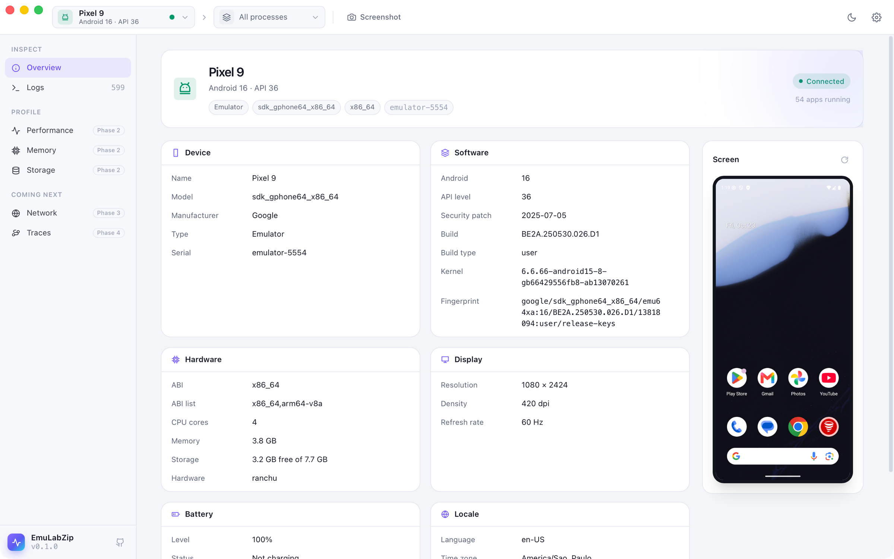

<p align="center">
  
</p>

<h1 align="center">EmuLabZip</h1>

<p align="center">
  <b>Inspect, monitor and debug the apps running in your Android emulators and iOS simulators.</b><br />
  A fast, beautiful, open-source developer lab written in Rust.
</p>

<p align="center">
  <a href="https://github.com/LuisPeixoto/EmuLabZip/actions/workflows/ci.yml"></a>
  <a href="LICENSE"></a>
  <a href="https://github.com/LuisPeixoto/EmuLabZip/releases"></a>
  
  
  <a href="CONTRIBUTING.md"></a>
</p>

<p align="center">
  <a href="#install">Install</a> ·
  <a href="#features">Features</a> ·
  <a href="docs/getting-started.md">Getting started</a> ·
  <a href="docs/logs.md">Logs</a> ·
  <a href="docs/cli.md">CLI</a> ·
  <a href="docs/architecture.md">Architecture</a> ·
  <a href="docs/roadmap.md">Roadmap</a> ·
  <a href="CONTRIBUTING.md">Contributing</a>
</p>

<p align="center">
  
</p>

EmuLabZip connects to your running emulators and simulators on its own and brings everything you reach for while
debugging into one window: what the device is, what it is logging, which apps are running and what is on its screen.
Performance, memory, storage, network and tracing tools arrive phase by phase, all built on the same small Rust core.
It ships as a native desktop app and as a command-line tool.

## Highlights

- **Android and iOS, side by side.** Android emulators and devices through a pure-Rust ADB client, iOS simulators
  through `simctl`. Switch between them in one click.
- **Zero setup.** Start an emulator or boot a simulator and it shows up. Nothing is installed on the device.
- **Logs that keep up.** logcat and the iOS unified log in one virtualized table that stays smooth at thousands of
  lines per second, with level, tag, text, regex and per-app filters.
- **Everything about the device.** OS and build, hardware, display, battery, storage and locale, with a live screen
  preview. Click any value to copy it.
- **Native and light.** A Rust core with a Tauri interface: a small download, a fast start and low memory use.
- **Scriptable.** The `emulabzip` command prints tables for people and JSON for scripts.
- **Built on public interfaces.** No private frameworks and no on-device agents, so it keeps working when Xcode and
  Android Studio update. Read [how the official tools work](docs/research/how-the-official-tools-work.md).

## Screenshots

<p align="center">
  <br />
  <sub><b>Logs</b>: logcat and the unified log, filtered as you type.</sub>
</p>

<table>
  <tr>
    <td width="50%"><br /><sub><b>Devices</b>: Android emulators and iOS simulators in one picker.</sub></td>
    <td width="50%"><br /><sub><b>Light theme</b>: every screen in light and dark.</sub></td>
  </tr>
</table>

## Features

| | Android | iOS Simulator |
|---|:---:|:---:|
| Automatic device discovery | ✅ | ✅ |
| Device overview (OS, build, hardware, display, battery, locale) | ✅ | ✅ |
| Installed and running apps | ✅ | ✅ |
| Live log streaming with filters and export | ✅ | ✅ |
| Screenshots and live screen preview | ✅ | ✅ |
| Command line | ✅ | ✅ |
| CPU, memory, frame rate and battery charts | Phase 2 | Phase 2 |
| Memory breakdown, snapshots and heap dumps | Phase 2 | Phase 2 |
| File browser, SQLite inspector, preferences | Phase 2 | Phase 2 |
| Network inspector | Phase 3 | Phase 3 |
| Perfetto, simpleperf and Instruments traces | Phase 4 | Phase 4 |
| Crashes, device controls and an MCP server | Phase 5 | Phase 5 |

See the [roadmap](docs/roadmap.md) for what each phase contains.

## Install

### Desktop app

Download the installer for your system from the [latest release](https://github.com/LuisPeixoto/EmuLabZip/releases):
`.dmg` for macOS (Apple silicon and Intel), `.msi` or `.exe` for Windows, and `.deb`, `.rpm` or `.AppImage` for
Linux.

You also need the tools for the platforms you work with:

- **Android**: the SDK platform tools (`adb`), which Android Studio installs.
- **iOS**: a Mac with Xcode.

### Build from source

You need [Rust](https://rustup.rs) (stable), [Node.js](https://nodejs.org) 20 or newer and, on Linux, the
[Tauri system dependencies](https://tauri.app/start/prerequisites/#linux).

```bash
git clone https://github.com/LuisPeixoto/EmuLabZip.git
cd EmuLabZip/apps/desktop
npm install
npm run tauri build
```

### Command-line only

```bash
cargo install --git https://github.com/LuisPeixoto/EmuLabZip emulabzip-cli
```

Pre-built CLI archives are attached to every release as well.

## Quick start

```bash
emulator -avd Pixel_9            # or: xcrun simctl boot "iPhone 17"
emulabzip devices                # what is running
emulabzip info                   # what it is
emulabzip logs --level warn      # what it says
emulabzip screenshot             # what it shows
```

In the desktop app, pick the device in the top-left corner, then your app next to it. Read the
[getting started guide](docs/getting-started.md) for a tour.

## Documentation

| Guide | What it covers |
|-------|----------------|
| [Getting started](docs/getting-started.md) | Install, connect a device, find your way around |
| [Android](docs/android.md) | How EmuLabZip talks to ADB, environment variables, device states |
| [iOS Simulator](docs/ios-simulator.md) | Requirements, what `simctl` provides, taming the unified log |
| [Logs](docs/logs.md) | Filters, regular expressions, pausing and export |
| [Command line](docs/cli.md) | Every `emulabzip` command and option |
| [Architecture](docs/architecture.md) | Crates, the backend trait, streams and design rules |
| [How the official tools work](docs/research/how-the-official-tools-work.md) | What we learned from Instruments and the Android Studio profilers |
| [Troubleshooting](docs/troubleshooting.md) | Devices that do not show up, empty logs, failing screenshots |
| [Distribution](docs/distribution.md) | Releases, code signing and updates |
| [Roadmap](docs/roadmap.md) | The phases ahead |

## Project layout

```
crates/
  emulabzip-core       Device model, log filters, streams and the backend trait
  emulabzip-adb        Async client for the ADB host protocol (devices, shell, exec, sync)
  emulabzip-android    Android backend: logcat, getprop, dumpsys, pm, ps, screencap
  emulabzip-apple      iOS Simulator backend: simctl, log stream, listapps
  emulabzip-cli        The `emulabzip` command
apps/desktop
  src-tauri            Tauri 2 shell (Rust)
  src                  Svelte 5 + TypeScript + Tailwind CSS UI
```

## Contributing

Contributions of every size are welcome: bug reports, documentation, UI polish and new collectors. Start with
[CONTRIBUTING.md](CONTRIBUTING.md) and look for issues labelled
[`good first issue`](https://github.com/LuisPeixoto/EmuLabZip/labels/good%20first%20issue).
Please follow the [Code of Conduct](CODE_OF_CONDUCT.md). To report a vulnerability, see [SECURITY.md](SECURITY.md).

## License

[MIT](LICENSE) © Luis Peixoto and EmuLabZip contributors.
