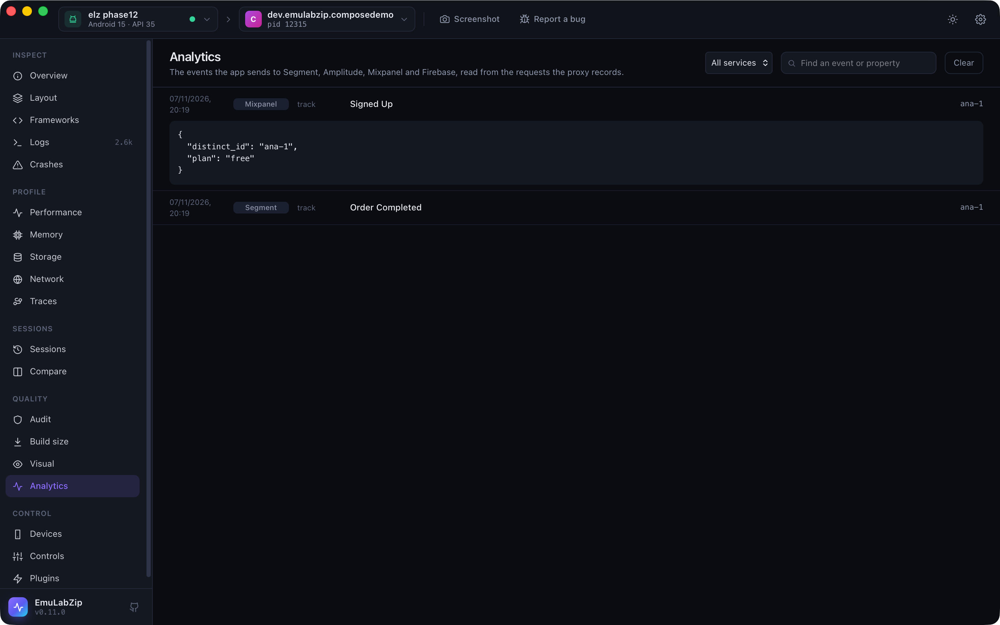

# Analytics inspector

<p align="center">
  
</p>

See the events an app sends to **Segment**, **Amplitude**, **Mixpanel** and **Firebase Analytics**, decoded, as they
happen, in a list of their own.

```bash
emulabzip analytics                          # runs the proxy, points the device at it, prints each event
emulabzip analytics --service segment,mixpanel --json
emulabzip analytics --firebase-log           # Firebase's debug-mode lines from the device log
```

Analytics calls are ordinary requests, so they stay in the Network list too. The inspector reads their host, address,
headers and body, which is why it works on anything the proxy records, and on a session or HAR opened later.

## What is decoded

| Service | Host | What |
|---------|------|------|
| Segment | `*.segment.io`, `*.segment.com` | `/v1/track`, `/v1/identify`, `/v1/page`, `/v1/screen`, `/v1/group`, `/v1/alias` and `/v1/batch`: JSON, one call or a batch |
| Amplitude | `*.amplitude.com` | The HTTP API (`/2/httpapi`, `/batch`: JSON with `events`) and the older form body (`e=`), with event and user properties |
| Mixpanel | `*.mixpanel.com` | `/track` and `/import` (`data=` in base64, in the body or the query, or plain JSON) and `/engage` profile changes |
| Firebase Analytics | `app-measurement.com` | The batch protobuf of `/a`: event names, parameters and times, after the body's `Content-Encoding` is undone |

Each event is a service, a kind (`track`, `screen`, `page`, `identify`, `profile`…), a name, its properties, the user (or
the anonymous or device id) and its time when it has one.

Firebase can also be read **without the proxy**. With debug mode on for the app
(`adb shell setprop debug.firebase.analytics.app <package>`), Firebase writes each event to the log under the tag `FA`, and
`emulabzip analytics --firebase-log` prints them.

## On the desktop

The **Analytics** view lists the events of the requests the proxy has recorded, newest first, with a filter by service
and a search over names and properties. Open an event to see its properties. Start the proxy on the **Network** view first.

## Limits

- SDKs that **pin their certificate** are passed through unchanged and cannot be read. Firebase's debug log works for them.
- Firebase's batch layout is the one of Google's measurement protocol as it is understood today, and the decoder was tested
  on payloads made to that layout, **not on traffic captured from a live Firebase app**. When Google changes it, events
  may be missing: say so in an issue, with a capture if you can.
- Events are decoded on request, not stored: an event in a request the proxy no longer holds is gone.
- Over [MCP](mcp.md) there is no analytics tool: the server runs no proxy.
