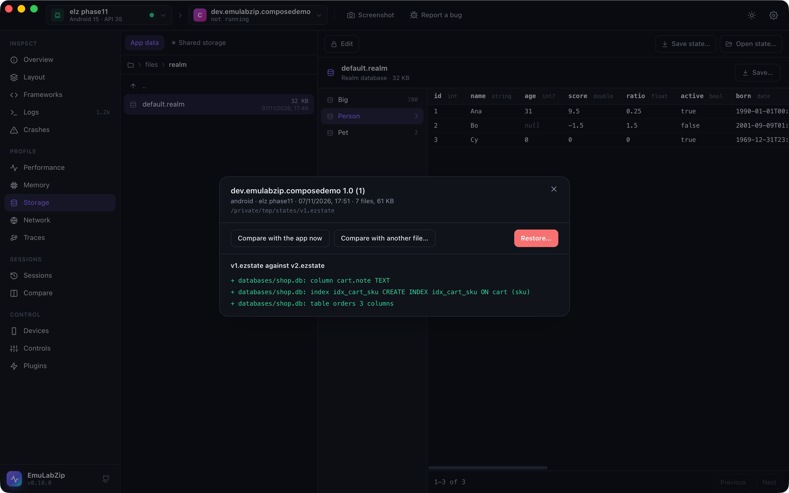

# App state: save, restore and compare

<p align="center">
  
</p>

An app's state is what it keeps: databases, preferences, files. **Save state** puts all of it in one `.ezstate` file;
**Restore** puts it back; **compare** says what changed in its structure between two saves. It is what you need to
repeat a bug from the same data every time, to test a migration, and to start a test from a known place.

```bash
emulabzip state save com.example.shop -o v1.ezstate
# …use the app, or install the new version…
emulabzip state save com.example.shop -o v2.ezstate
emulabzip state diff v1.ezstate v2.ezstate
emulabzip state restore v1.ezstate --yes
```

## What is saved

| | Android | iOS Simulator |
|---|---------|---------------|
| What | The app's private folder (`/data/data/<package>`) except `cache`, `code_cache` and `lib`; with `--external`, also its folder on shared storage | The data container (`Documents`, `Library`, `tmp`) |
| How | `run-as <package> tar` (the app must be **debuggable**, as for [Storage](storage.md)) | A tar of the container, written by EmuLabZip |
| The app | Is stopped first, so no file is half written | Is terminated first |

A `.ezstate` file is a zip: `state.json` (the app, its version, the device, the time), the tar, and `schemas.json`, a
description of every SQLite database (tables, columns, indexes) and every preferences, DataStore and property list file
(keys and types). That description is what makes comparing fast: nothing has to be unpacked.

## Restoring

`state restore` replaces the app's data with what is in the file. It:

1. refuses a file made on another platform, and warns when the app is another version than the one the state came from;
2. needs `--yes` (the desktop app asks first);
3. **saves the data it replaces** to a file in `states/auto/` of EmuLabZip's data folder, and prints its name. Restoring
   that file undoes the restore. If the backup cannot be made, nothing is replaced;
4. stops the app, empties the app's folder (keeping `lib` on Android), unpacks the tar, and says if anything failed.

Every entry of a tar is checked before anything is written: no absolute paths, no `..`, no hard links, no devices, and
no symbolic link that points out of the folder. A `.ezstate` file from someone else cannot write outside the app.

Android runs the unpacking as the app (`run-as`), so the files keep the app as their owner.

## The schema diff

One line per change: `+` added, `-` removed, `~` changed, then the file, what it is and its name, and the detail.

```
$ emulabzip state diff v1.ezstate v2.ezstate
+ databases/shop.db: column cart.note  TEXT
+ databases/shop.db: index idx_cart_sku  CREATE INDEX idx_cart_sku ON cart (sku)
+ databases/shop.db: table orders  3 columns
```

It lists tables, columns (and their type, `NOT NULL` and primary key), indexes, and the keys and types of preferences,
DataStore and property list files, added, removed or changed. Row contents are not compared: this is for checking a
migration, not for diffing data. `state diff v1.ezstate` with no second file compares against the app as it is now.
`--json` gives it as data.

## In the desktop app

Storage has **Save state…** and **Open state…** in its toolbar. An opened state shows what is inside and offers
**Compare with the app now**, **Compare with another file…** and **Restore…**. Restore asks first, and says where the old
data is kept.

## For assistants

Over [MCP](mcp.md), `save_state` and `diff_state` are offered, and `list_states` shows the saved names. Restoring is
**not**: an assistant can see what changed, not replace an app's data.

## Limits

- Android needs a debuggable app. A release build's private folder cannot be read by any tool.
- Data held only in memory, the keychain, and what other apps keep for this one (accounts, content providers) are not part of the
  folder, so they are not part of the state.
- iOS: app group containers are not saved.
- A state does not include the app itself: install the same version before restoring.
