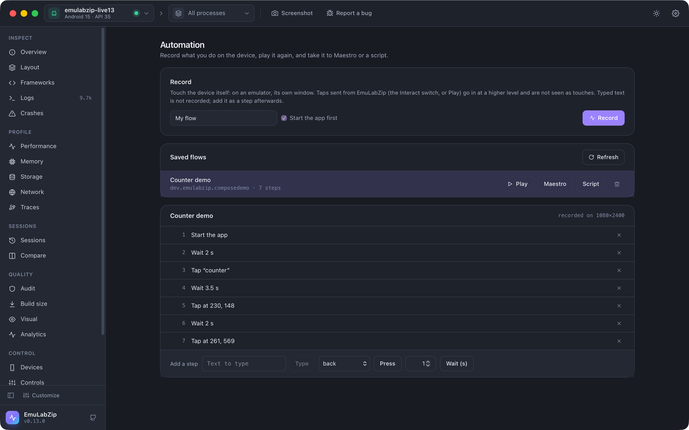

# Input and flows

EmuLabZip can touch a device, type on it and press its keys; it can **record** what you do into a **flow**, play the flow
again, and export it as a [Maestro](https://maestro.mobile.dev) flow or as a shell script. All of it is for **Android**:
iOS has no public way to send touches or to read them.

## Touch, type and press

| Control | CLI | What it does |
|---------|-----|--------------|
| Tap | `emulabzip control tap <x> <y>` | A touch at a point of the screen, in pixels, as in a screenshot. |
| Swipe | `emulabzip control swipe <x1> <y1> <x2> <y2> [--ms 300]` | A drag. From a point to itself it is a long press. |
| Text | `emulabzip control text "hello"` | Types into the field that has focus. Printable ASCII only. |
| Key | `emulabzip control key back` | `back`, `home`, `app_switch`, `enter`, `tab`, `delete`, `volume_up`… |
| Launch | `emulabzip control launch <app>` | Starts an app as the launcher would. Also on iOS. |

Positions are checked (at most 20000 pixels), text is checked (it cannot contain `%s`, which Android reads as a space, or
anything `input text` cannot type), and keys are a list of names, so nothing reaches a shell unchecked. The same controls are
[MCP tools](mcp.md): `tap`, `swipe`, `input_text`, `press_key`, `launch_app`.

In the app, **Overview → Screen → Interact** makes the picture of the screen touchable: a click is a tap, a drag is a swipe,
and a press held for half a second is a long press. **Controls** has a card for text and keys.

## Recording a flow

```bash
emulabzip flow record --name "Add to cart" --app com.example.shop     # touch the emulator, then press Ctrl+C
```

Touch the device itself: on an emulator, its own window. EmuLabZip reads the touchscreen (`getevent`) and keeps each tap,
long press and swipe, and the pauses between them (a pause of a second or more, to the nearest tenth of a second). The flow
starts with a step that launches the app, unless you pass `--no-launch`.

Two things are not recorded, and the app says so:

- **Taps sent by EmuLabZip or by `adb shell input`.** They go in higher up in Android and never reach the touchscreen, so
  clicking the Interact picture or playing a flow while recording does not add steps.
- **Typed text.** The keyboard is not the touchscreen. Add a text step afterwards.

After each touch the screen is read again in the background, so the next tap can remember **what it hit**: the id of the view
(a Compose `testTag`, an Android resource id) or its text. Reading a screen takes two or three seconds, so a tap that comes
sooner than that after another is kept as a point.

Flows are JSON files in EmuLabZip's `flows` folder, shared by the app and the command line:

```bash
emulabzip flow list
emulabzip flow show add-to-cart          # the steps; --json for the file
emulabzip flow play add-to-cart          # Ctrl+C stops it
emulabzip flow remove add-to-cart
```

Playing scales the points to the screen it plays on, when its size differs from the one the flow was recorded on. A
step is followed by a third of a second, so the screen can react.



## The Automation view

**Automation** in the sidebar records and plays flows, lists the saved ones, and shows the steps of the one you pick. You can
delete a step, or add a text, a key or a pause by hand, then **Save changes**. **Maestro** and **Script** save the flow in
those formats.

## Export

```bash
emulabzip flow export add-to-cart --maestro > add-to-cart.yaml
emulabzip flow export add-to-cart --script --out add-to-cart.sh
```

**Maestro.** A tap that knows its view says `tapOn: id: "checkout"` or `tapOn: "Checkout"`; the others say a point as a
percentage of the screen (`point: "50%,80%"`). Text is escaped for Maestro's regular expressions, then quoted for YAML. Keys use
Maestro's names (`Back`, `Home`, `Enter`, `Backspace`…), and a key it has no name for is left as a comment. Pauses become
`waitForAnimationToEnd`. The file has no assertions: add them, since a recording knows what you did and not what it should show.

**Script.** A shell script of `emulabzip control …` lines with `sleep`s between them, for the device in `EMULABZIP_DEVICE`.

## Limits

- Android only. A flow cannot be recorded or played on a simulator.
- Labels are best effort. A screen that changes without a touch (a timer, a network answer) can give a tap the name of
  what was there a moment before; the point is always kept, and Maestro uses the label only when there is one.
- A flow has at most 5000 steps, and a pause at most a minute. An assistant's `play_flow` refuses flows that take more than
  two minutes; play them with `emulabzip flow play`.
