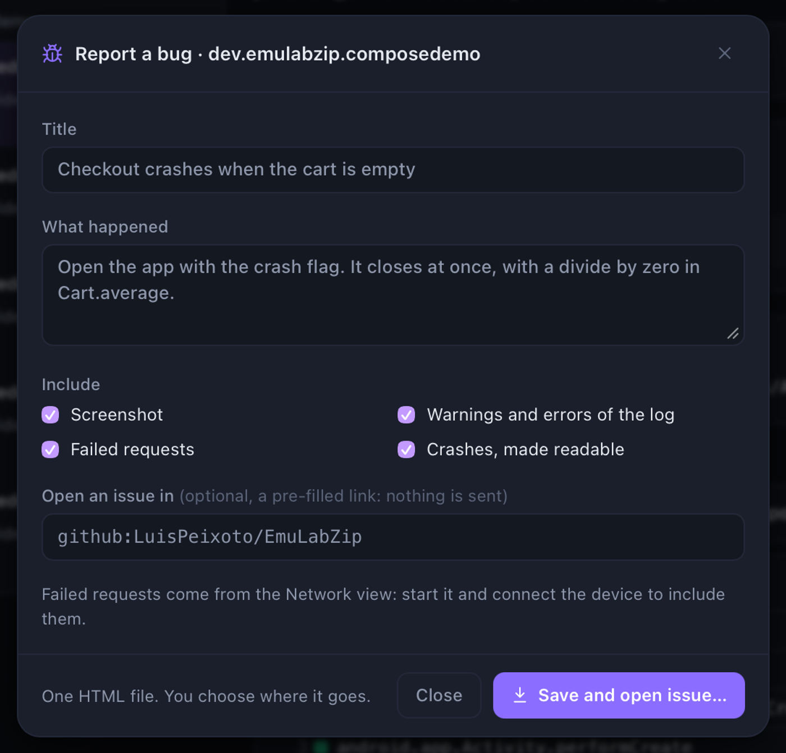
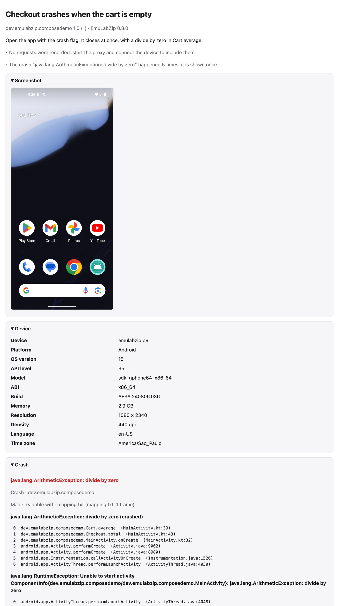
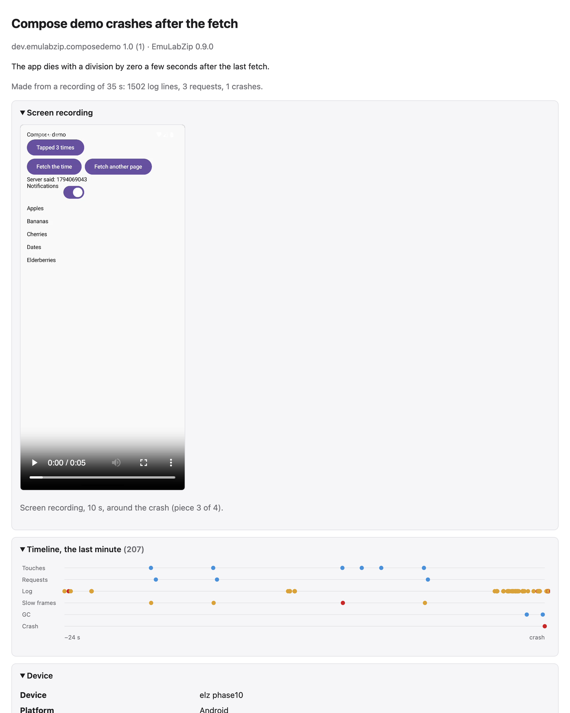

# Bug reports

A bug report needs the same things every time: what the screen looked like, what device and app, what the log said,
which requests failed and how the app crashed, readable. EmuLabZip packs them into **one HTML file** and, if you want,
opens a new issue with a summary already filled in.

<p align="center">
  
</p>

Nothing is sent anywhere. You see the file, and you decide where it goes.

## Quick start

In the desktop app, press **Report a bug** in the toolbar. Write what happened, choose what to include, and press
**Save HTML…**. If you name a tracker, the pre-filled issue opens in your browser and the file is shown in its folder,
ready to be attached to it.

From a terminal:

```bash
emulabzip report --app com.example.shop -o report.html
emulabzip report --app com.example.shop --issue github:owner/repo --open
emulabzip report --session run.ezsession -o report.html       # from a recording
```

## What is in the file

<p align="center">
  
</p>

| Part | What it holds |
|------|---------------|
| Screenshot | The screen as it is now (or the last one of a session), inside the file |
| Screen recording | From a session that has video: the piece that holds the crash, or the last one. Up to 20 MB it is part of the file; a bigger clip is written next to it as `emulabzip-report.mp4`, which the file refers to |
| Timeline strip | From a session: the last minute before the crash (or the end of the run), one row per kind of thing: touches, requests, log problems, slow frames, garbage collections, the crash. Drawn from numbers, with no script |
| Device | The name, OS, model, ABI, memory, screen, language and time zone |
| Crashes | The ones of the last 30 minutes, read with the mappings, source maps and dSYMs kept for the app: see [Readable stacks](symbolication.md) |
| Failed requests | Requests that got no answer or a status of 400 and up, with the error and the start of the answer. They come from the proxy in [Network](network.md), so start it and connect the device first |
| Log | The warnings and errors (errors first when there are many), and the last lines |

<p align="center">
  
</p>

The file has no script and loads nothing from a server, so it opens the same in any browser, offline, years later.
Everything in it is escaped, so text from a log or a response can never become markup. Lists are capped, and a very
big screenshot is left out with a note, so a report stays something a person can read.

Leave a part out when it should not leave your machine: `--without screenshot`, `logs`, `requests`, `crashes` or `video`
(repeat it for more), or the checkboxes in the dialog.

## Opening an issue

`--issue` takes a tracker:

| Tracker | Write it as |
|---------|-------------|
| GitHub | `github:owner/repo` |
| GitLab | `gitlab:group/project`, or `gitlab:git.example.com/group/project` for a server of your own |
| Jira | `jira:yoursite.atlassian.net/PROJECTID/ISSUETYPEID`, both ids being numbers |

The link opens the tracker's new-issue page with the title and a summary filled in: the description, the app and
device, the crash and its first frames, the failed requests and the first errors of the log. The summary is cut to fit
the length trackers accept, and ends with a line that the full report is attached. You attach the HTML file yourself.
No token is asked for or kept, because EmuLabZip never talks to the tracker: your browser does, with your own login.

## From a recording

A [session](sessions.md) already holds the logs, requests, crashes and screenshots of a run, so a report can be made
from one later, or from a CI run: open it in **Sessions** and press **Bug report**, or

```bash
emulabzip report --session run.ezsession -o report.html
```

## For assistants

`create_bug_report` writes the file to `reports/` in EmuLabZip's data folder and returns its path, a Markdown summary
and, with `issue`, the link. A report with a clip too big for the file gets a folder of its own, with the clip in it.
See [MCP](mcp.md).

## What to check before you share it

A report holds what was on the screen and in the log of your app, and the addresses of the requests that failed. A clip
of the screen can show anything that was on it. Read and watch it before it goes into an issue that others can see, and
use `--without` for what should stay out. See
[Security](../SECURITY.md).
