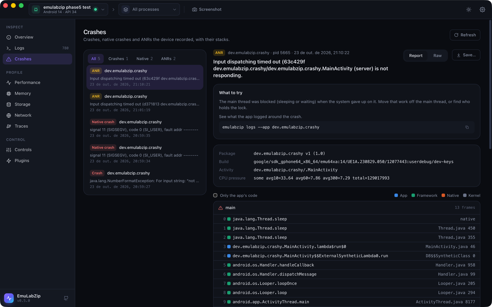

# Crashes

The Crashes tool lists the crashes, native crashes and ANRs a device has recorded, and opens each one with its stack,
the facts the device wrote down and what to try next. New ones show up by themselves, with a notification and a badge
in the sidebar, while EmuLabZip is open.

| Kind | Android | iOS Simulator |
|------|---------|---------------|
| **Crash** | An uncaught exception, with its `Caused by:` chain | A Swift runtime failure, an `abort()` or an uncaught `NSException` |
| **Native crash** | A fatal signal, from the tombstone | A bad memory access (`EXC_BAD_ACCESS`) and similar |
| **ANR** | Application Not Responding, with the stack of every thread | not applicable |

<p align="center">
  
</p>

## Quick start

1. Open **Crashes** (<kbd>⌘8</kbd>). The newest crash opens by itself.
2. Pick another one on the left, or filter by kind, or by the app picked in the toolbar.
3. **Report** shows the hints, the details and the threads. **Raw** shows the report as the device wrote it. **Save…**
   writes it to a file.

From a terminal:

```bash
emulabzip crashes --app com.example.app          # newest first, with an id for each
emulabzip crash dropbox:data_app_crash:20261023205928
emulabzip crash <id> --all-threads               # every thread, not only the one that crashed
emulabzip crash <id> --raw                       # as the device wrote it
```

## Where the reports come from

**Android.** The system keeps a copy of every crash, ANR and tombstone in DropBox, and the shell may read it with
`dumpsys dropbox --print <tag>`. That means it works on any device and any emulator, with no root and nothing
installed. EmuLabZip reads `data_app_crash`, `system_app_crash`, `data_app_native_crash`, `SYSTEM_TOMBSTONE`,
`data_app_anr` and `system_app_anr`. The ids look like `dropbox:data_app_crash:20261023205928`. The system rate-limits
repeated crashes of one app, so a crash that loops is listed less often than it happens.

**iOS Simulator.** macOS writes a `.ips` report to `~/Library/Logs/DiagnosticReports` when a process crashes, simulated
apps included. A report belongs to a simulator when the app's path runs through
`CoreSimulator/Devices/<udid>`. EmuLabZip reads the newest 200 files there and in `Retired`. The ids look like
`ips:MyApp-2026-10-23-210246.ips`. macOS writes the report a few seconds after the crash.

## Reading a report

The thread that crashed is open; the others are folded away. For an ANR the blocked main thread comes first. Each frame
has a coloured square for whose code it is, the same four colours as the flame graph:

| Colour | Meaning |
|--------|---------|
| Blue | The app's own code |
| Green | The platform: the Android framework and runtime, UIKit, Foundation, the Swift runtime |
| Orange | Native libraries |
| Grey | The kernel |

**Only the app's code** hides everything else, which is how to read a native stack that is mostly runtime internals.

A Java crash shows one section per exception of the chain, and the last one, the root cause, is the one marked as
crashed. The title of the crash is that root cause.

## Hints

EmuLabZip says what it can tell from the report:

- Class names that look obfuscated: map them back with `retrace` and the build's `mapping.txt`.
- Native frames of the app without symbols: `ndk-stack -sym <folder> -dump tombstone.txt`, or `llvm-symbolizer`. The
  BuildId has to match the build that crashed.
- iOS frames of the app without symbols: the `atos` command to run with the build's dSYM, with the architecture and
  the load address filled in.
- An ANR whose main thread was sleeping or waiting: the main thread was blocked.
- An ANR on a device that was short of CPU: the app may not be at fault.
- A native crash whose signal came from `kill()`: it was sent, not raised by a fault.

## Try it

`tools/crash-app` (Android) and `tools/crash-app-ios` (iOS Simulator) are tiny apps that fail on purpose, so you can
see each kind without writing one. Each has an `install.sh` and a README.
