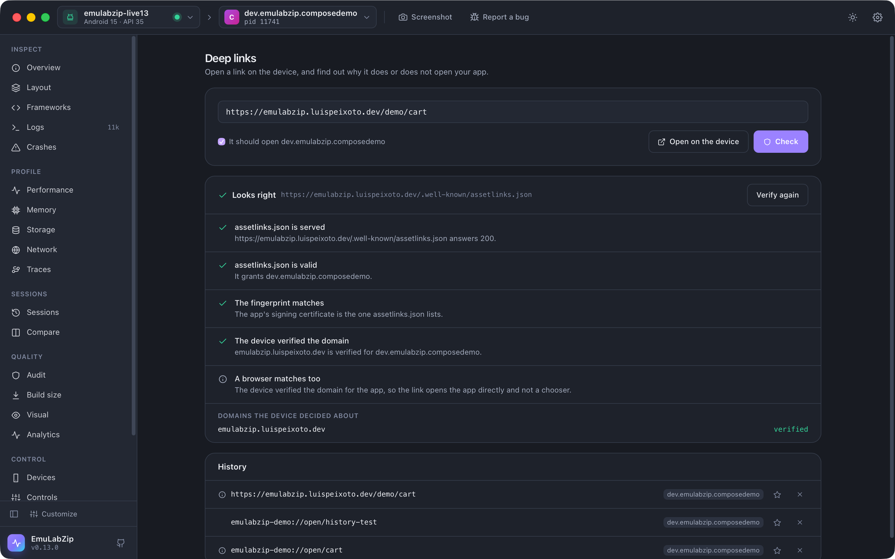

# Deep links

A web link opens an app, instead of the browser, only when two things agree: the **domain** says the app may (a file on its
website), and the **app** claims the domain. When one side is wrong, the link opens the browser and nothing says why.
**Deep links** opens a link on the device and **checks** both sides.

## In the app

Open **Deep links** in the sidebar, type a link, and:

- **Open on the device** opens it, and remembers it;
- **Check** reads the domain's file, asks the device what it decided, and lists what is right (✓), what to look at (!) and
  what is wrong (✗), each with what to do about it.

The history keeps the last 100 links with the result of their last check, and **pins** the ones you use often.



## On the command line

```bash
emulabzip link open "myapp://open/cart" --app com.example.shop
emulabzip link check "https://shop.example.com/cart/3" --app com.example.shop        # exits with an error when something is wrong
emulabzip link verify com.example.shop       # asks Android to verify the app's domains again
emulabzip link history
```

`link check --json` prints the findings, for CI. [MCP](mcp.md) has `check_link`.

## What is checked

**On Android**

- `https://<domain>/.well-known/assetlinks.json` is served with status 200, without a redirect (Android does not follow
  them), as `application/json`, and is valid;
- it grants the app: its package name is in a statement with `delegate_permission/common.handle_all_urls`;
- the app's **signing certificate matches**: the SHA-256 the device reports (`pm get-app-links`, Android 12 and later) is
  one the file lists. A debug build is signed with the debug key, not the release key;
- the **device verified the domain** for the app, and the user's "Open supported links" switch is on; when it is not, the fix
  is `pm verify-app-links --re-verify <app>`, which **Verify again** and `link verify` run;
- **who opens the link** (`cmd package resolve-activity`): your app, another app, or nobody. A chooser that lists a browser is
  not reported when the domain is verified, because a verified link goes straight to the app.

**On iOS**

- `https://<domain>/.well-known/apple-app-site-association` is served with 200, without a redirect, and is valid
  (`applinks` with `components`, or the older `paths`);
- the app's bundle id is in `appIDs`, and a **rule matches the link's path**: the first matching component decides, and an
  `exclude` rule can turn it away;
- the app's **Associated Domains entitlement** has `applinks:<domain>`, and its team id is the file's (read from the app's
  signature on the simulator; an unsigned build has none, and that is said).

**For a link of the app's own scheme** (`myapp://…`) there is no domain file; the check says who opens it.

## Limits

- A simulator does not verify domains the way a device does, so the iOS check is about the files and the entitlement.
- `pm get-app-links` needs Android 12 or later. On older versions the file is still checked.
- Only the domain's own file is read, over HTTPS, at most 256 KB, with a ten second limit.
- The website's `apple-app-site-association` is served as `application/octet-stream` by GitHub Pages, and the check says so: a
  host that cannot set the type will show that warning. Apple accepts the file in practice; use another host if you want
  the type right.

## The demo

`tools/compose-app` handles `https://emulabzip.luispeixoto.dev/demo` as a verified app link, and `emulabzip-demo://open/…` as
a link of its own. The website serves an `assetlinks.json` that lists the demo and the debug key it is built with, so
`emulabzip link check https://emulabzip.luispeixoto.dev/demo/cart --app dev.emulabzip.composedemo` shows every ✓ on an emulator
that has the demo installed. Its `apple-app-site-association` uses a placeholder team id on purpose, so the iOS check shows
what a mismatch looks like.
