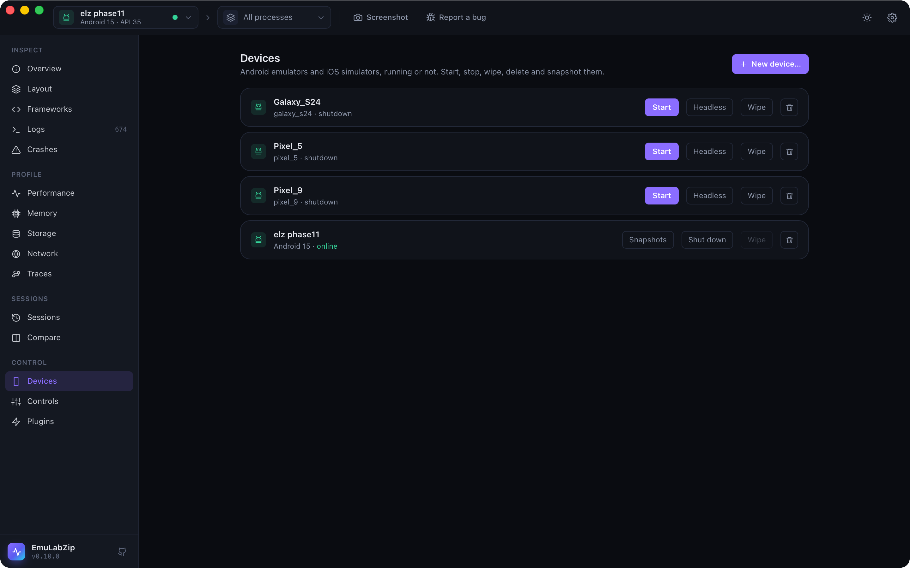

# Devices: emulators and simulators

<p align="center">
  
</p>

The **Devices** view and the `avd`, `sim` and `snapshot` commands make, start, stop, wipe and delete emulators and
simulators, and keep an emulator's snapshots. Until now EmuLabZip only saw devices that were already running.

```bash
emulabzip devices --all                       # running or not; a stopped one has the state "shutdown"
emulabzip avd options                         # system images and device definitions
emulabzip avd create Pixel_Test --image "system-images;android-35;google_apis;arm64-v8a" --model pixel_6
emulabzip avd boot Pixel_Test --headless
emulabzip snapshot save before-login -d emulator-5554
emulabzip snapshot load before-login -d emulator-5554 --yes
emulabzip avd shutdown Pixel_Test
emulabzip avd wipe Pixel_Test --yes
emulabzip avd delete Pixel_Test --yes
```

`sim` is the same for the iOS Simulator (`sim options` lists runtimes and device types; `sim wipe` is also `sim erase`).

## What needs `--yes`

Anything that throws data away: `wipe` (`erase`), `delete`, `boot --wipe` and `snapshot load` and `delete`. The command
says what it needs before it looks for any device. The desktop app asks in a dialog. Starting, stopping, creating and
saving a snapshot need nothing.

A running device is not deleted, and an Android emulator is not wiped while it runs: shut it down first.

## Android

| | How |
|---|-----|
| List | `~/.android/avd/*.ini` (or `ANDROID_AVD_HOME`) joined with what `adb` sees; an emulator that is not running has the id `avd:<name>` |
| Options | The system images installed under the SDK, and `avdmanager list device` |
| Create, delete | `avdmanager` |
| Start | `emulator -avd <name>`, detached, until `sys.boot_completed`; `--headless` has no window, `--cold` skips the quick-boot snapshot, `--wipe` starts from factory state |
| Stop | The emulator console (`kill`) |
| Wipe | Deletes the AVD's `userdata-qemu.img`, cache and snapshots, so it starts from factory state next time (the emulator must be stopped); `boot --wipe` starts with `-wipe-data` |
| Snapshots | The console: `avd snapshot list`, `save`, `load`, `del` |

The SDK is found from `ANDROID_HOME`, `ANDROID_SDK_ROOT` and the usual folders. A running emulator reports its name with
underscores turned into spaces; EmuLabZip matches the two.

## iOS Simulator

`simctl create`, `boot`, `shutdown`, `erase` and `delete`, with the runtime and device type identifiers from
`simctl list`. `delete` of a booted simulator is refused here (`simctl` itself would
allow it).

## Names

A name is letters, digits, `.`, `_` and `-`, up to 64 characters, so it can never carry anything to `avdmanager`,
`emulator` or `simctl`. Images and runtimes also allow `;` and `:`.

## For assistants

Over [MCP](mcp.md): `list_all_devices`, `boot_device`, `shutdown_device`, `list_emulator_snapshots` and
`save_emulator_snapshot`. Booting never wipes. Wiping, deleting and loading a snapshot are **not** offered.
