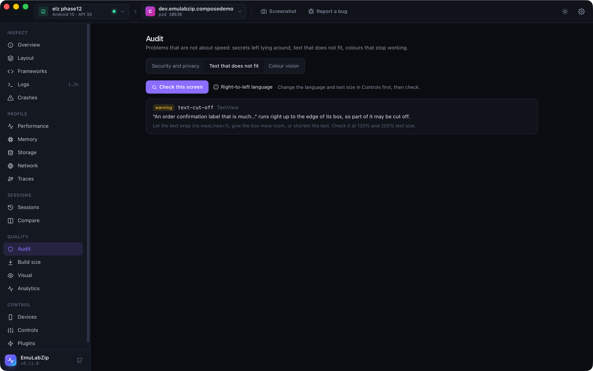

# Language, text size and text that does not fit

<p align="center">
  
</p>

Text is where layouts break: a German word is longer, Arabic runs right to left, a person who needs big text sets it to
200%. EmuLabZip can **change** the language and text size of a device, **check** the screen for text that does not fit, and
**sweep** a screen across several languages and sizes in one command.

## Changing the device

```bash
emulabzip control locale en-XA --app com.example.shop   # long, accented text
emulabzip control locale ar-XB --app com.example.shop   # right to left
emulabzip control reset-locale --app com.example.shop
emulabzip control font-scale 130                        # percent of normal; 100 puts it back
emulabzip control display --width 720 --height 1600 --density 320     # Android
emulabzip control reset-display
```

| | Android | iOS Simulator |
|---|---------|---------------|
| Language | `cmd locale set-app-locales`: **one app at a time**, Android 13 and newer. The pseudo-locales `en-XA` and `ar-XB` work. The app is told and recreates its screen | `defaults write -g AppleLanguages` and `AppleLocale` for the **whole simulator**; an app picks it up **when it starts again** |
| Text size | `settings put system font_scale` | `simctl ui … content_size`: the Dynamic Type size nearest the percentage (130% is `extra-extra-extra-large`, 200% `accessibility-extra-large`) |
| Display size and density | `wm size`, `wm density` | Not available |

A language tag is letters, digits and hyphens (`de-DE`, `pt-BR`, `zh-Hans-CN`). Text size is 50 to 300 percent. All of
these are in the **Controls** view too, under *Text size and language* and *Display size*.

## Checking a screen

```bash
emulabzip i18n check            # the screen as it is now
emulabzip i18n check --rtl      # it is shown in a right-to-left language: also check the layout was mirrored
```

| Rule | Looks for |
|------|-----------|
| `text-off-screen` | Text that reaches past the edge of the screen (unless it is in something that scrolls) |
| `text-clipped-by-parent` | Text that does not fit inside its container, so the container cuts it |
| `text-cut-off` | A single line of text held to the room it was given, whose ink reaches the end of its box: it is probably cut off or ends in an ellipsis |
| `rtl-not-mirrored` | In a right-to-left language, most of the screen's text still on the left |

`text-cut-off` is a heuristic. The layout says where each view is, and the screenshot says whether its text runs to the end of
the box. A label that merely hugs its text is not reported (its box is only as wide as the text), and a label is only
reported when its box ends where its container, or the next view in its row, leaves no room. The message says "may be".
Without a screenshot only the layout rules run.

## Sweeping

```bash
emulabzip i18n sweep --app com.example.shop --locales en-XA,ar-XB --scales 100,130,200
```

The sweep tries each language at each text size, reads the layout, and prints a table: how many findings, which, and
**which are worse than the device as it is now**. The device is put back (text size and language) when it finishes, and
also when a step fails. `--fail-on-worse` exits with 1 when any setting is worse. On the iOS Simulator only text sizes are
swept, because an app only takes a new language when it starts again.

Text scaling is also looked at through the sweep: at 200% it reports touch targets and focus order that got worse.

## For assistants

Over [MCP](mcp.md): `control_locale`, `control_font_scale`, `control_display_size` and `check_text`.

## Limits

- Android changes the language of an app, not the device. Device-wide languages need root.
- The heuristics see views, not glyphs. An icon font, a custom-drawn label or text in a game is not judged.
- Pseudo-locales rely on the app having its strings in resources; hard-coded text stays as it is.
