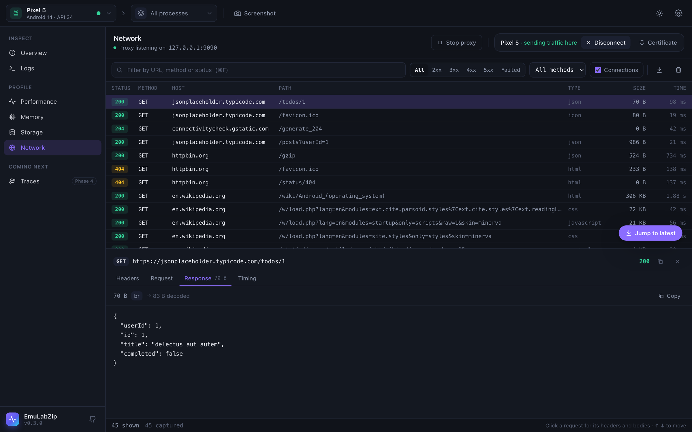

# Network

The Network tool is a debugging proxy built into EmuLabZip. It sits between your app and the internet, decrypts HTTPS
with a certificate authority that lives only on your computer, and lists every request with its headers, body and
timing. You do not change your app.

<p align="center">
  
</p>

## Quick start

1. Open **Network** (<kbd>⌘6</kbd>) and pick your device.
2. Press **Certificate** once per device, so it trusts EmuLabZip's certificate (see [below](#the-certificate)).
3. Press **Connect**. The proxy starts if it is not running, and the device sends its HTTP and HTTPS traffic to it.
4. Use your app. Requests appear as they finish. Click one to see its headers, body and timing.
5. Press **Disconnect** (or just quit) when you are done. EmuLabZip puts the device back the way it found it.

From a terminal:

```bash
emulabzip ca install                 # once per device
emulabzip net --har capture.har      # Ctrl+C to stop; the device is restored
```

## How a device reaches the proxy

The proxy only listens on `127.0.0.1` of your computer, never on the network.

| | Android | iOS Simulator |
|---|---------|---------------|
| Route | `adb reverse tcp:<port> tcp:<port>` makes `127.0.0.1:<port>` on the device reach your computer, then `settings put global http_proxy 127.0.0.1:<port>` | The simulator shares the Mac's network, so the **Mac's own** HTTP and HTTPS proxy is pointed at EmuLabZip |
| Scope | The one device you connect | **Every app on the Mac** while it is on |
| Undone by | Disconnect, quitting, or `emulabzip net` stopping. Only the forward EmuLabZip made is removed; Metro's `tcp:8081` stays | Disconnect, quitting, or the next start if EmuLabZip was killed |
| Works with | Emulators, USB devices, wireless debugging | Simulators on macOS |

For the Mac, EmuLabZip saves the proxy settings of every network service before changing them and writes them back
exactly, including a proxy that was switched off but still has an address. If macOS asks for an administrator
password the first time, that is `networksetup` changing system settings.

## The certificate

To read HTTPS, EmuLabZip answers with a certificate for the site, signed by its own certificate authority. The
device has to trust that authority. It is created on first use, named *EmuLabZip CA*, and kept in
`~/Library/Application Support/EmuLabZip` (`%APPDATA%\EmuLabZip` on Windows, `~/.local/share/EmuLabZip` on Linux),
with the private key readable only by you. Set `EMULABZIP_HOME` to use another folder.

| Device | What **Certificate** does | Which apps trust it |
|--------|---------------------------|---------------------|
| iOS Simulator | `simctl keychain add-root-cert` | All of them. Restart apps that were already running |
| Android emulator whose image allows `adb root` (Google APIs, AOSP) | Adds it to the **system** store | **Every app**, until the device restarts |
| Android image from Google Play, or a physical device | Copies `emulabzip-ca.crt` to Downloads and opens Settings so you can install it as a **user** certificate | Chrome and apps that opt in. Your own debug builds can opt in with the snippet below |

On a rootable image `adbd` is left running as root, as after `adb root`. Running **Certificate** again is safe: it
replaces the file instead of stacking another copy.

### Letting your debug build trust it

Since Android 7 apps ignore user certificates unless they ask for them. Add this to your **debug** build only and
reference it from the manifest of that build (`android:networkSecurityConfig="@xml/network_security_config"`):

```xml
<?xml version="1.0" encoding="utf-8"?>
<network-security-config>
    <debug-overrides>
        <trust-anchors>
            <certificates src="system" />
            <certificates src="user" />
        </trust-anchors>
    </debug-overrides>
</network-security-config>
```

Release builds are not affected, because `debug-overrides` only applies to debuggable apps.

### Without installing anything

With the proxy running, a browser on the device can fetch the certificate from the proxy itself:
`http://127.0.0.1:9090/ca.crt` (DER, for Android and iOS) or `/ca.pem`.

## What you see

Each row is one request. The columns are the status, method, host, path, type, size and time. Filter by text (URL,
method or status), by status class, or by method. Use <kbd>↑</kbd> <kbd>↓</kbd> to move through the list.

The detail pane has four tabs:

| Tab | Shows |
|-----|-------|
| Headers | Request and response headers |
| Request | The body that was sent |
| Response | The body that came back |
| Timing | The protocol, time to the first byte and time to the end |

Bodies are decoded for reading (gzip, deflate, Brotli, zstd): you see the size on the wire and the decoded size.
JSON is formatted, images are shown, and binary data is shown as a hex dump. The proxy forwards the bytes exactly as
they were; only the copy you read is decoded.

**Connections** are what the proxy could not decode: non-HTTP traffic, and apps that refuse the certificate. They are
listed so you know they exist, with the reason. WebSockets are listed with a **Messages** tab that shows each message
(see [WebSocket messages](websockets.md)).

The **Proto** column shows what the proxy spoke to the server: `h1`, `h2` or `h3`.

## More than watching

- **Rules**: answer a request yourself, slow it down, block it or stop it and edit it. See
  [Mocks and breakpoints](mocks.md).
- **Import**: open a `.pcap` or `.pcapng` capture as requests. See [Importing a capture](pcap.md).
- **HTTP/3**: see below.

### Apps that pin their certificate

Some apps (many Google services, banking apps) accept only their own server's certificate. EmuLabZip cannot decrypt
them without breaking them, so after a host rejects the certificate once, later connections to it are **passed
through** unchanged. The app keeps working, the list shows one failed connection with the reason, and a banner names
the hosts. **Decrypt again** retries them, for example after you installed the certificate.

## Export

The download button saves the requests as a [HAR](http://www.softwareishard.com/blog/har-12-spec/) file, readable by
Chrome DevTools, Firefox and most API tools. Bodies are stored decoded. Connections are left out. On the command
line: `emulabzip net --har capture.har`.

## HTTP/3

A device behind an HTTP proxy never speaks QUIC to it, so HTTP/3 only concerns the proxy's second leg, to the server.
Servers announce HTTP/3 in an `Alt-Svc: h3=":443"` header. The proxy remembers it per host, and with **HTTP/3 → Use HTTP/3
to servers** switched on (it is off by default), later requests to that host go over QUIC. If QUIC fails (a network that
blocks UDP, a server that does not answer), the request falls back to HTTP/2 or 1.1 and the host stays on TCP for 10
minutes. Flows show `h3` in the Proto column when it worked. An HTTP/3 response is read in full before it is passed on,
so a very large download is not streamed.

**Hide HTTP/3 from apps** (on by default) removes the `h3` entries from the `Alt-Svc` header the app receives. Without it
an app can learn that the server speaks HTTP/3 and try QUIC directly, around the proxy, and its traffic would vanish
from the list. The flow still records the original header. On the command line: `emulabzip net --http3`, and
`--show-h3` to show apps the offers.

## Limits

- Only the first **10 MB** of each body is stored. The rest still reaches its destination.
- The list keeps the newest **10,000** requests.
- An app that speaks QUIC directly, around the proxy, cannot be decoded. With the default setting apps are not told about HTTP/3, so they stay on HTTP/2 through the proxy.
- The proxy is for **your own** apps and devices. Do not point it at traffic you are not allowed to inspect.

## Command line

```bash
emulabzip net                       # the only running device; prints one line per request
emulabzip net --json | jq 'select(.status >= 400)'
emulabzip net --no-connect --port 9191   # only run the proxy
emulabzip net --rules rules.json    # mock, delay or block requests
emulabzip net --http3               # talk HTTP/3 to servers that offer it
emulabzip net import capture.pcap   # read a packet capture
emulabzip ca install                # make the device trust the certificate
emulabzip ca path                   # where the certificate file is
```

See [Command line](cli.md) for every option.
