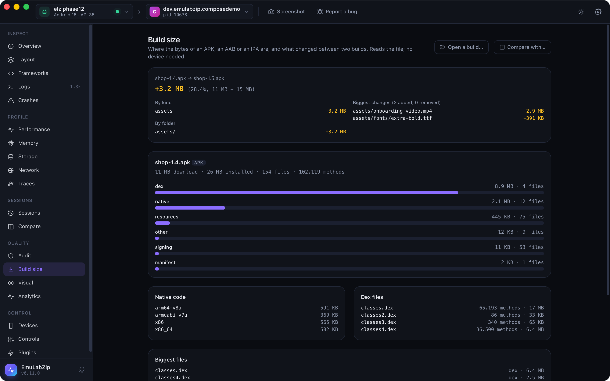

# Build size

<p align="center">
  
</p>

`emulabzip size` takes an APK, an AAB or an IPA apart and says where its bytes are, `emulabzip size diff` says what
changed between two builds, and a **size budget** in `emulabzip.toml` fails CI when a build grows too much. It reads the
file on this computer: no device, no SDK tool, no Xcode.

```bash
emulabzip size show app-release.apk
emulabzip size show app-release.aab --json
emulabzip size diff app-1.4.apk app-1.5.apk
emulabzip size diff app-1.4.apk app-1.5.apk --fail-on-growth 5      # exit 1 over 5% growth
emulabzip size show app-release.apk --budget --baseline app-1.4.apk # hold it to [size] in emulabzip.toml
```

## What you get

- The download size (compressed, as stored in the file) and the installed size, by **kind**: `dex` (compiled code),
  `native` (`lib/<abi>/*.so`, and on iOS the executable and `Frameworks/`), `resources`, `assets`, `manifest`, `signing`
  and `other`.
- Native code **per ABI** (`arm64-v8a`, `x86_64`…), so a build that ships four of them is plain to see. On an IPA,
  `Frameworks` and the executable.
- Each **dex file** with its classes and methods, read from its header, and the total against the 65,536 methods one
  dex file can hold.
- An AAB's **modules** (`base`, and the feature modules).
- The biggest files.
- With `diff`: the total and percentage, the change by kind and by folder, and the biggest files **added, removed and
  changed**.

A file is told to be an APK, an AAB or an IPA by what is inside it, not by its name.

## The budget

```toml
[size]
max_total_mb = 25          # the download size, compressed
max_dex_mb = 8
max_native_mb = 12
max_resources_mb = 6
max_methods = 60000        # all dex files together
max_growth_percent = 5     # against a baseline build (--baseline, or ci --size-baseline)
```

Sizes are megabytes (1,048,576 bytes) of **compressed** size. Every key is optional, an unknown key is an error, and a
growth limit with no baseline build is reported rather than passed. In CI:

```bash
emulabzip ci -o run.ezsession --size app-release.apk --size-baseline last-release.apk -- ./gradlew connectedCheck
```

The build is read before anything runs, so a missing file does not cost a test run. See [Budgets](budgets.md).

## On the desktop

The **Build size** view opens a build with a file dialog (no device needed), shows the bars by kind, the native code,
the dex files and the biggest files, and **Compare with…** a second build.

## Limits

- It does not open the compiled manifest or the dex bytecode: sizes, folders and the dex header only. For a class-level
  breakdown use Android Studio's APK Analyzer.
- It does not yet read the installed app from a device: pull the file first (`adb shell pm path`, `adb pull`).
- Over MCP (`analyze_package`, `diff_packages`) a file is accepted only with an `.apk`, `.aab` or `.ipa` extension.
