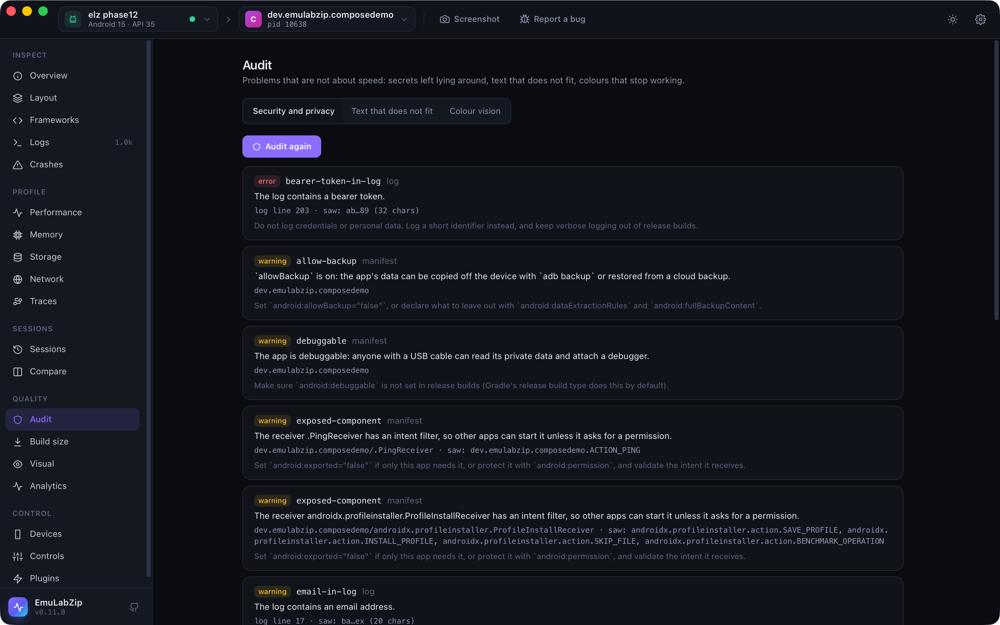

# Security and privacy audit

<p align="center">
  
</p>

`emulabzip audit security <app>` and the **Audit** view look for what an app should not leave lying around: secrets and
personal data in the log, in preferences and in databases, plain HTTP and secrets in requests, flags like `debuggable`
and `allowBackup`, components other apps can reach, App Transport Security exceptions and gaps in an iOS privacy manifest.
Every finding says what it is, where, and how to fix it.

```bash
emulabzip audit security com.example.shop
emulabzip audit security com.example.shop --har run.har       # also look at recorded requests
emulabzip audit security com.example.shop --only manifest,storage --json
emulabzip audit security com.example.shop --fail-on error     # exit 1 when something at least this serious is found
```

**Secrets are never repeated.** Evidence is cut down to the first two and last two characters and the length
(`ey…Xk (131 chars)`), in the terminal, in JSON, in the report and over MCP.

## What it looks at

| Area | Rules |
|------|-------|
| **Manifest** (Android, from `dumpsys package`) | `debuggable`, `allow-backup`, `old-target-sdk` (below API 34), `exposed-component` (a receiver, service or activity with an intent filter, apart from the launcher), `content-provider` (listed; `dumpsys` does not say if it is exported) |
| **Manifest** (iOS, `Info.plist`) | `ats-arbitrary-loads`, `ats-arbitrary-loads-scoped` (web content, media), `ats-insecure-domain` (plain HTTP allowed for a domain), `ats-old-tls` |
| **Privacy** (iOS) | `no-privacy-manifest`, `tracking-not-declared`, `undeclared-tracking-domain`: the advertising and analytics domains the app was seen using, against `PrivacyInfo.xcprivacy` |
| **Traffic** (recorded requests) | `cleartext-traffic` (once per host; `localhost`, `10.0.2.2` and `*.local` are not reported), `secret-in-url` (a token or key in the query string), and, over plain HTTP only, `<kind>-in-cleartext-body` |
| **Log** | `<kind>-in-log` |
| **Storage** | `<kind>-in-storage` (SharedPreferences, DataStore, MMKV, property lists), `secret-in-storage` (a key named like a secret with a value), `sensitive-column` (a SQLite column named `password`, `token`, `api_key`…) |

`<kind>` is `jwt`, `bearer-token`, `api-key` (Google, AWS, Stripe, GitHub and Slack key shapes), `secret`, `email` or
`card-number` (a number that passes the Luhn check, so order numbers are not taken for cards). Placeholders such as
`password=****` and `${TOKEN}` are left alone, and so are dates and binary data under a secret-sounding name.

## Where the requests come from

The audit reads requests from the proxy. On the desktop app, start the proxy on the **Network** view first: the audit
then includes what it has recorded. On the command line, pass a HAR file (`--har`, from `emulabzip net --har`). A body is
only judged when the request went over plain HTTP, because over HTTPS it is the app's business what it sends the server.

## The log

The device log is shared by every app. EmuLabZip reads the lines of the app's own process (and those that mention it), so
the app has to be running. For an app that is not, the area is reported as **not read** instead of scanning the system's
lines, which would be other people's secrets and numbers that only look like cards.

## In `ci`

```bash
emulabzip ci -o run.ezsession --app com.example.shop --network --fail-on-security warning -- ./gradlew connectedCheck
```

After the command, the audit runs (with the requests the proxy recorded) and the run fails when a finding is at least
that serious. The findings are in the Markdown summary. See [CI mode](ci.md).

## Limits

- `dumpsys package` does not print the `exported` attribute. A component with an intent filter is reachable by other
  apps, and that is what is reported; one without a filter but exported is not seen.
- Android storage and the app's files can only be read for **debuggable** apps, as in [Storage](storage.md).
- The patterns find what looks like a secret. A short or unusual one is missed, and a value that looks like one is
  reported: read the finding before acting on it.
- iOS: the log is only read while the app runs; privacy declarations are compared with the domains seen in recorded
  requests, so record some first.
- It is a first pass, not a penetration test. It does not look inside the app's code or its server.

## For assistants

Over [MCP](mcp.md), `audit_security` returns the same findings. It reads; it changes nothing on the device.
