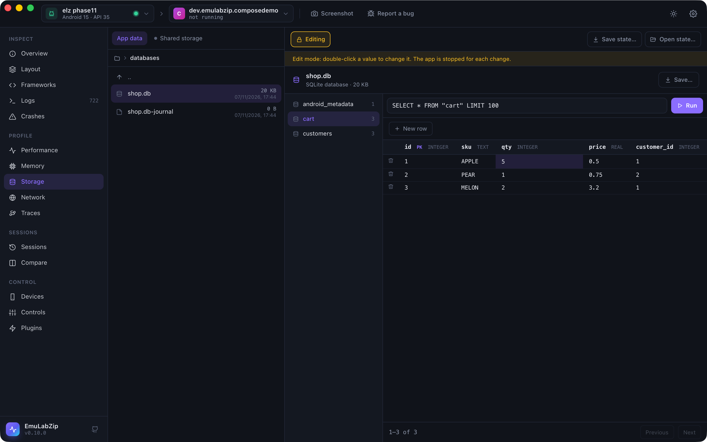

# Changing an app's data

<p align="center">
  
</p>

[Storage](storage.md) is read-only until you turn on **Edit**. Editing changes the app's real files on the device, so it
is built to be careful: every change asks first, stops the app, keeps the file it replaces, reads the new file back to
check it, and can be undone.

## What can be changed

| File | Desktop | Command line |
|------|---------|--------------|
| SQLite rows | Double-click a cell; **New row**; the bin on a row | `edit cell`, `edit insert`, `edit delete` |
| SharedPreferences | Double-click a value; **New key**; the bin | `edit pref-set`, `edit pref-remove` |
| Property lists (iOS) | — | `edit plist-set`, `edit plist-remove` |

DataStore, MMKV, AsyncStorage, Realm and Core Data are read-only: their formats are not written back.

```bash
emulabzip edit cell com.example.shop databases/shop.db -t customers --rowid 1 --text name=Ana --set vip=1 --yes
emulabzip edit insert com.example.shop databases/shop.db -t customers --set name=Bo --yes
emulabzip edit delete com.example.shop databases/shop.db -t cart --pk id=3 --yes
emulabzip edit pref-set com.example.shop shared_prefs/settings.xml theme dark --yes
emulabzip edit pref-set com.example.shop shared_prefs/settings.xml launches 4 --as int --yes
emulabzip edit plist-set com.example.shop Library/Preferences/com.example.shop.plist flags/beta true --as boolean --yes
emulabzip edit undo <data folder>/states/edits/<folder> --yes      # the folder the edit printed
```

A value is a whole number or a decimal where it looks like one and text otherwise; `--text column=value` forces text and
`--null column` sets NULL. A set preference is its items separated by commas. Every command needs `--yes`.

## What an edit does

1. Checks the change **before** the device is touched: the table and column exist, one row matches the key, the value
   has the type that was asked for.
2. Stops the app, so it does not write over the change when it exits.
3. Keeps the bytes it is about to replace in a backup folder (`states/edits/` in EmuLabZip's data folder).
4. Writes: for SQLite, the database and its write-ahead log are pulled, the change is made on a copy inside a
   transaction that must change **exactly one row**, with foreign keys on, the log is folded into the file
   (`wal_checkpoint(TRUNCATE)`), the file is pushed, and the device's `-wal` and `-shm` are removed so the old log is not
   replayed over the new file.
5. Reads the file back. If it is not what was written, the old one is put back and the edit fails.

A row is found by `rowid`, or by its primary key for tables made `WITHOUT ROWID`. A table with no usable key is shown
with the reason and cannot be edited. Views cannot be edited.

On Android the file is written through `run-as`, so it keeps the app as its owner; on iOS it is a host file write that
refuses a path whose symbolic links leave the container.

## Undo

The desktop app has **Undo last change**. On the command line each edit prints the folder to give to `edit undo`. Undo
stops the app and puts every file of that edit back, or removes it if it did not exist.

For anything bigger, [save the app's state](app-state.md) first.

## For assistants

Editing is **not** offered over [MCP](mcp.md).
