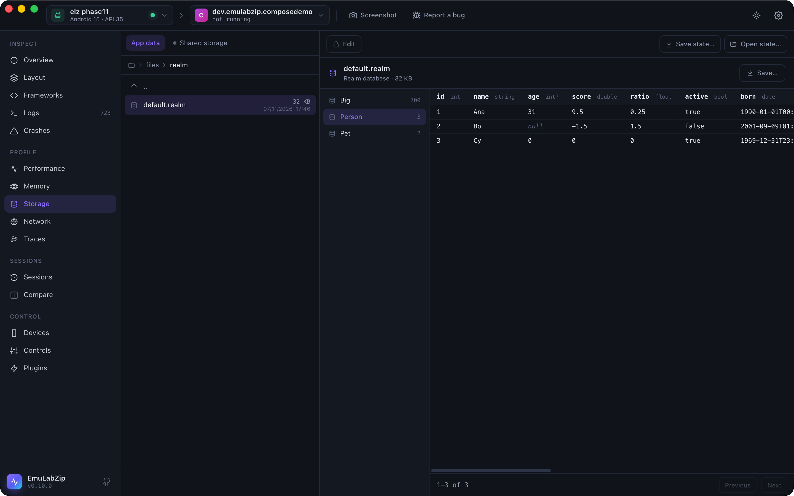

# Storage

The Storage tool browses the files of the app selected in the toolbar and opens the common formats in place.

## Where you can look

| Root | Android | iOS Simulator |
|------|---------|---------------|
| App data | `/data/data/<package>`, read with `run-as`. **Debuggable apps only.** | The data container (`Documents`, `Library`, `tmp`) |
| Shared storage | `/sdcard/Android/data/<package>`, through the ADB sync protocol | — |
| App bundle | — | The installed `.app` |
| App groups | — | Every app group container the app uses |

Debug builds of your app are debuggable by default. Release builds and most preinstalled apps are not, and Android
does not let any tool read their private data. EmuLabZip says so instead of showing an empty folder.

To try the tools without an app of your own, install the sample app: `tools/sample-app/install.sh`.

## Viewers

| File | Viewer |
|------|--------|
| SQLite databases | Tables and views with row counts, column types and primary keys, 100 rows per page, and a read-only SQL box |
| SharedPreferences (`shared_prefs/*.xml`) | Key, type and value; sets show their items |
| Preferences DataStore (`datastore/*.preferences_pb`) | Key, type and value, decoded from the protobuf |
| Proto DataStore (`datastore/*.pb`) | The protobuf decoded without its schema: field numbers and values |
| MMKV (a file in `mmkv/` next to its `.crc`) | Key and value. MMKV does not store types, so each value is shown as the type it looks like (string, number, bytes, set) and says it is a guess; the raw hex is one click away. An encrypted file is recognised and explained |
| Realm (`*.realm`) | Classes with their row counts, column types and rows, read a page at a time with a reader of Realm's file format (versions 20 to 24). Lists, links and timestamps are shown; sets, dictionaries, mixed, decimal and UUID columns are not read yet and say so |
| AsyncStorage (`RKStorage`, or `manifest.json` on iOS) | Keys and values, with JSON values pretty-printed |
| Core Data (a SQLite store) | Entities with their attributes and rows (the `Z` prefix removed), next to the raw tables |
| Property lists (binary or XML) | Pretty-printed as JSON |
| JSON | Pretty-printed |
| Images (PNG, JPEG, GIF, WebP) | Preview on a checkerboard |
| Text | As is, up to 2 MB |
| Anything else | The first 4 KB as a hex dump |

Databases are copied to a private temporary folder together with their `-wal` and `-shm` files, so changes the app
has not checkpointed yet are visible. The copy is opened with `query_only` on: queries can read but never write, and
the app's real database is never touched. Temporary copies are deleted when EmuLabZip quits.

**Save…** copies the original file to a place you choose.



## Changing and saving

Storage is read-only until you turn on **Edit**: see [Changing an app's data](storage-editing.md). **Save state…**,
**Open state…** and the schema diff are in [App state](app-state.md).

## From the command line

```bash
emulabzip files com.example.app                   # the first readable root
emulabzip files com.example.app databases --root data
emulabzip pull com.example.app shared_prefs/settings.xml
emulabzip db com.example.app databases/app.db                     # tables
emulabzip db com.example.app databases/app.db --table users       # rows
emulabzip db com.example.app databases/app.db -q "SELECT count(*) FROM users"
emulabzip edit cell com.example.app databases/app.db -t users --rowid 1 --text name=Ana --yes   # see Changing an app's data
```
