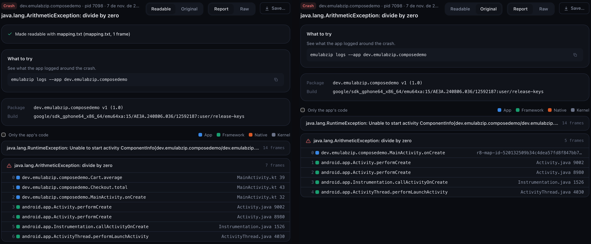

# Readable stacks

A release build hides its names. R8 and ProGuard rename classes to `a.b.c`, React Native ships one JavaScript bundle
where every position is `1:608617`, and an iOS app without symbols has bare addresses. EmuLabZip reads them back into
what you wrote, when it has the file the build made for that purpose.

| What crashed | The file | What you get |
|--------------|----------|--------------|
| Java or Kotlin, minified with R8 or ProGuard | `mapping.txt` | `Cart.average` in `MainActivity.kt:39`, with inlined calls given back as frames of their own |
| React Native JavaScript (Hermes or JavaScriptCore) | the source map of the bundle | `App.tsx 17:14` instead of `1:608617` |
| An iOS app | its `.dSYM` | function, file and line for each address (on a Mac, with `atos`) |

<p align="center">
  
</p>

## Quick start

Keep the file for the app and the version it belongs to, once. Every crash of that build is read with it from then on.

```bash
emulabzip mappings add com.example.shop "1.2.0 (42)" app/build/outputs/mapping/release/mapping.txt
emulabzip crash dropbox:data_app_crash:20261023205928        # readable
emulabzip crash dropbox:data_app_crash:20261023205928 --raw  # as the device wrote it
```

In the desktop app, open **Crashes**. A crash that could be read better says what is missing and offers **Add mapping or
source map…** and **Add dSYM…**: pick the file and the crash is read again. **Readable** and **Original** switch
between the two.

## The version has to match

A mapping is only right for the build that made it, and reads another build worse than not at all. So files are kept
per app and version, and a crash is only read with the ones for its own version. The version is the one the crash
shows:

- **Android**: `1.2.0 (42)`, the version name and the version code, from the `Package:` line of the report.
- **iOS**: `1.2.0 (42)`, the short version and the build number.

When no file fits, the crash says so and names the version it needs.

## Where the files are

You can keep them anywhere and name them on the command line, one crash at a time:

```bash
emulabzip crash <id> --mapping app/build/outputs/mapping/release/mapping.txt
```

or keep them for good with `mappings add`. They are copied into EmuLabZip's data folder
(`~/Library/Application Support/EmuLabZip/mappings/<app>/<version>/` on macOS), so a clean build does not take them
away. `emulabzip mappings list` shows what is kept, and `emulabzip mappings remove <app> <version>` forgets a version.
What a file is gets worked out from the file itself, so there is no kind to give; `--kind mapping|sourcemap|dsym`
says it when it cannot be told.

## Android: mapping.txt

R8 writes it to `app/build/outputs/mapping/<variant>/mapping.txt` when `isMinifyEnabled` is on. Keep it for every
release you ship: it is the only way back from the names in a crash.

- Frames are given back with class, method, file and line.
- When R8 inlined a method into its caller, the one scrambled frame becomes the whole chain, inner call first, as it
  would have been without R8.
- The class names in the title of the exception are restored too.
- Keep `-keepattributes SourceFile,LineNumberTable` in your rules, or there are no lines to give back.

## React Native: source maps

The JavaScript of a React Native crash comes in the report as an exception text, not as frames. EmuLabZip reads it into
a **JavaScript** thread with the Java and native threads after it. The positions are looked up in the source map of the
bundle:

- **Hermes** release builds write a composed map, `android/app/build/generated/sourcemaps/react/release/index.android.bundle.map`.
  Use that one; the `packager` and `compiler` maps next to it are the two halves it is made of.
- **JavaScriptCore** and **Metro** bundles use the map `react-native bundle --sourcemap-output` writes.

## iOS: dSYM

Xcode writes a `.dSYM` next to every archive. EmuLabZip checks that its UUID is the one of the image that crashed, then
asks `atos` for every address of that image at once. This needs a Mac, because `atos` is part of Xcode's tools; on
Linux and Windows a crash with bare addresses says so, and a crash that already has names is shown as it is. The
Simulator often symbolicates the crash report itself when it can find the dSYM, and then there is nothing left to do.

## A stack from somewhere else

A stack you copied from a log, a bug report or a CI run can be read the same way:

```bash
emulabzip symbolicate stack.txt --mapping mapping.txt
adb logcat -d | emulabzip symbolicate - --mapping mapping.txt
```

Java frames are read with a `mapping.txt` and JavaScript frames with a source map. A `.dSYM` needs the addresses and
the image of a crash report, which a pasted stack does not have.

## For assistants

`get_crash` reads the crash with what is kept for its app and version, and says which files it used and what is missing
(`symbolication`). `original: true` keeps the names as the device wrote them. See [MCP](mcp.md).
