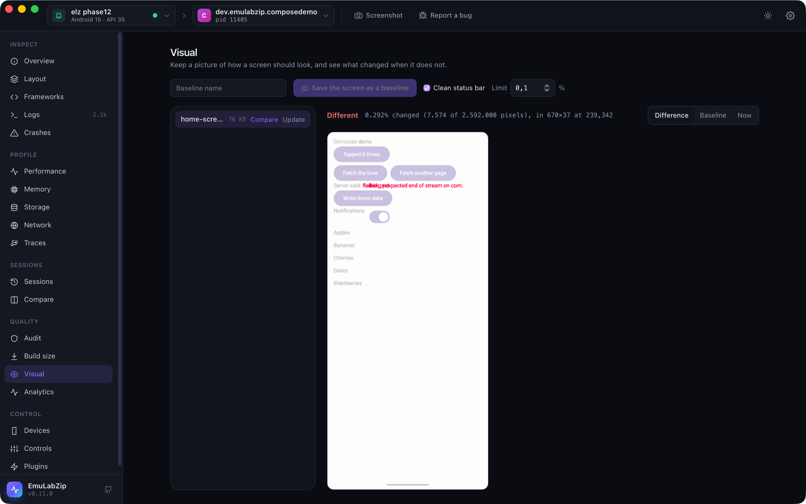

# Visual regression

<p align="center">
  
</p>

Keep a picture of how a screen should look (a **baseline**) and see what changed when it does not.

```bash
emulabzip visual capture home --status-bar          # save the screen as a baseline
emulabzip visual compare home --status-bar          # exit 1 when more than the limit changed; draws the difference
emulabzip visual update home --yes --status-bar     # accept the screen as the new baseline
emulabzip visual list
emulabzip visual diff a.png b.png -o diff.png       # two screenshot files
emulabzip visual session a.ezsession b.ezsession -o diffs/    # the screenshots of two recordings, in order
```

Baselines are PNG files in the `visual/` folder of the project (or `[visual] baseline_dir`), named with letters, digits,
`.`, `_` and `-`. A baseline is **never replaced by accident**: `capture` refuses a name that exists, and `update` needs
`--yes`.

## What counts as a change

Each pixel is compared with its baseline, channel by channel. A pixel counts as changed when a channel differs by more
than the **tolerance** (8 of 255 by default, which absorbs anti-aliasing and encoder rounding). The comparison reports
how many pixels changed, the percentage of the screen, and the smallest rectangle that holds every change. The difference
is drawn as a PNG, with the changed pixels in red over a faded copy of the screen. The limit is a percentage
(`--threshold`, 0.1 by default).

Screens of different sizes are not compared: they come from different devices, orientations or display sizes, and the
error says so.

## The clock and the battery

The status bar changes every minute. `--status-bar` shows a clean one for the shot (9:41, full battery and signal) and
puts the real one back afterwards, so those pixels are the same every time. Anything else that moves (an ad, a video, a
date) can be left out of the comparison with `ignore` regions.

## In `emulabzip.toml`

```toml
[visual]
threshold_percent = 0.1          # how much of the screen may change
tolerance = 8                    # how far a colour channel may differ before a pixel counts
baseline_dir = "ui/baselines"    # relative to the project; default "visual"

[[visual.ignore]]                # parts of the screen to leave out, in pixels
name = "clock"
x = 0
y = 0
width = 1080
height = 120
```

## In `ci`

```bash
emulabzip ci -o run.ezsession --visual home --fail-on-visual -- ./gradlew connectedCheck
```

After the command, the screen is compared with the baseline `home`, the result goes into the Markdown summary, and with
`--fail-on-visual` the run fails over the limit. The baseline is read before anything runs.

## Between devices

Compare two screenshots from two devices with `visual diff`, or capture on one and `compare -d <other>` on another. They
have to have the same size in pixels.

## On the desktop

The **Visual** view lists baselines (kept in EmuLabZip's own `visual` folder), saves the screen as one, compares it, and
shows the difference, the baseline or the screen now. **Update** asks before it replaces a picture.

## For assistants

Over [MCP](mcp.md), `visual_compare` returns the numbers and the difference picture. It does not create or replace a
baseline.

## Limits

- A baseline is a screenshot, so it can hold anything that was on the screen. Do not commit one of a screen with personal
  data.
- It compares pixels, not meaning: a one-pixel shift of everything changes everything. Use the tolerance and the limit
  to taste, and keep the status bar clean.
