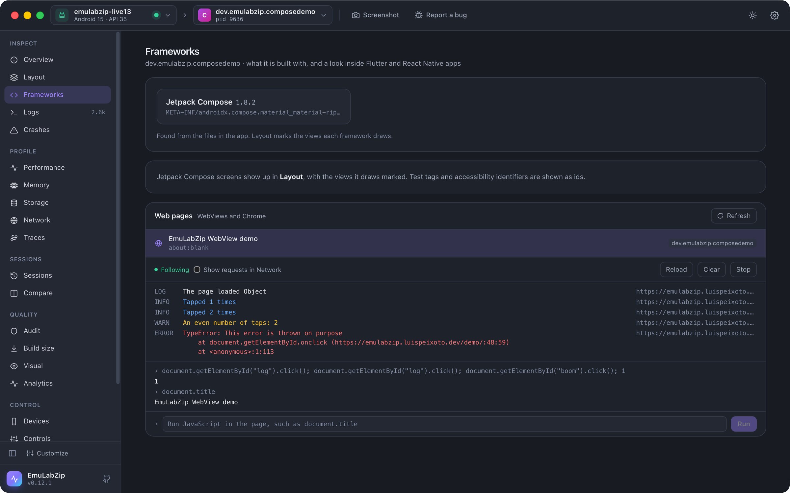
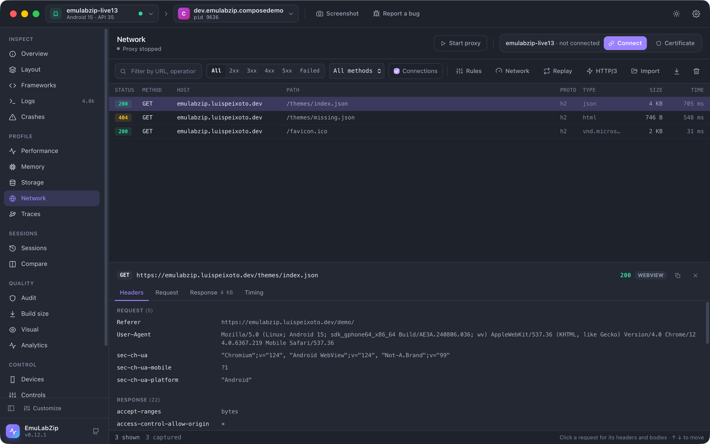
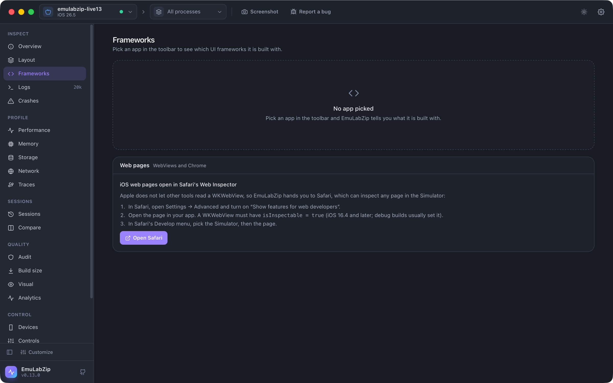

# Web pages in apps

Hybrid apps show web pages in a **WebView**. EmuLabZip reads them the way Chrome's DevTools does: it lists the pages, shows
their console, runs JavaScript in them, and shows the requests the page makes, in the Network view next to everything the
proxy saw. On iOS it hands you to Safari's Web Inspector.

## What an app has to allow

On Android a WebView can be inspected only when its app turns web debugging on:

```kotlin
WebView.setWebContentsDebuggingEnabled(true)   // in a debug build
```

Chrome on the device is listed too, while it is open. There is nothing to install and no port to forward: EmuLabZip reads
the device's list of open sockets, finds `webview_devtools_remote_<pid>` and `chrome_devtools_remote`, and talks to them through
ADB.

`tools/compose-app` has a screen for trying it: **Open the web page** starts a WebView with a page that writes to the
console, fetches from the website, fetches something missing and throws an error.

## In the app

**Frameworks → Web pages** lists every page that can be inspected, with the app it belongs to. Pick one and:

- the **console** follows live: logs, warnings, errors, and the errors the page does not catch, each with where it came from;
- the line at the bottom **runs JavaScript** in the page, such as `document.title`, and shows the value;
- **Reload** reloads the page, ignoring its cache;
- **Show requests in Network** also lists the page's requests in the [Network](network.md) view, marked **WEBVIEW**. Pick the
  page again after changing it.

The requests come from the page itself, so they appear even when the proxy could not decrypt the traffic (certificate
pinning does not matter to the page) and without installing a certificate. They cannot be changed or held at a breakpoint
the way proxied requests can; for that, use the proxy.





## On iOS

Apple does not let other tools read a `WKWebView`, so on a simulator the panel gives the steps and a button that opens Safari:



1. In Safari, open Settings → Advanced and turn on "Show features for web developers".
2. Open the page in your app. A `WKWebView` has to have `isInspectable = true` (iOS 16.4 and later; debug builds usually set it).
3. In Safari's **Develop** menu, pick the Simulator, then the page.

## On the command line

```bash
emulabzip webview list                                   # the sockets and their pages
emulabzip webview console --app com.example.shop         # what the page writes, for 10 seconds (--seconds N)
emulabzip webview eval "document.title"                  # run JavaScript; a script that throws fails the command
emulabzip webview network --reload --seconds 10 --har page.har
```

`--app` picks the app's WebView, `--socket` a socket by name, `--page` a page by id or by part of its address. Each can be
left out when there is only one choice. `--json` is available on each command.

## From an assistant

`webview_list` and `webview_console` are [MCP tools](mcp.md). Running JavaScript is not offered over MCP, because a script
can change what the app stores; it stays in the app and on the command line.

## Limits

- Android only, and only debuggable WebViews and Chrome. A release build that did not turn debugging on cannot be read.
- Response bodies are read up to 10 MB. A body that is gone from the browser's memory by the time it is asked for is shown
  without its text.
- The page is read through one connection of its own. Another debugger (`chrome://inspect`) can be open at the same time.
